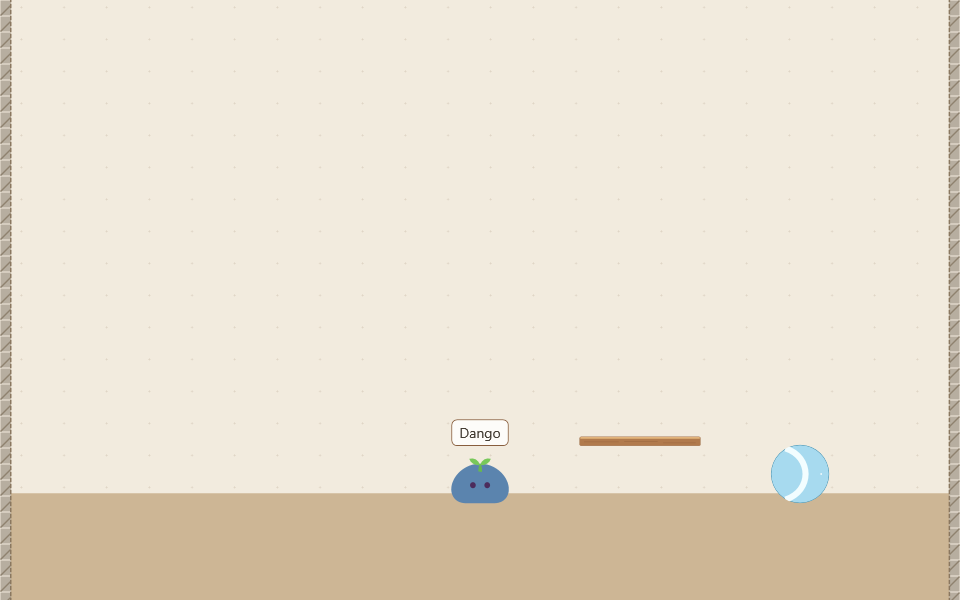
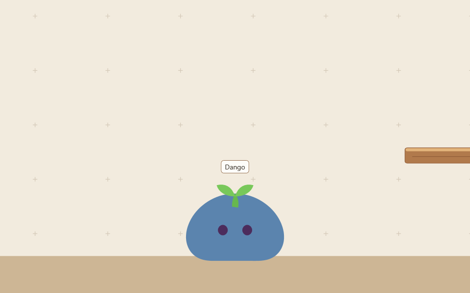

# 演示素材

以下是**真实产品场景离屏渲染示例**：使用产品 `LocalRoomSceneView`、房间 driver 和实际编译的 Belt native 模块，生成虚构团子及家具的画面。它们不是完整应用截图，也不构成桌面交互、真实输入、实时性能或人工验收证据。





## 后台复现

在 Windows 开发环境完成 [构建准备](../development-environment.md) 后，于仓库根目录执行：

```powershell
dotnet build eng/tools/Dango.LocalRoomProbe/Dango.LocalRoomProbe.csproj -c Release
$probe = 'eng/tools/Dango.LocalRoomProbe/bin/Release/net10.0-windows/Dango.LocalRoomProbe.dll'
$run = Join-Path (Get-Location) ('artifacts/local-room-catalog/runs/public-preview-' + (Get-Date -Format 'yyyyMMdd-HHmmssfff'))
$module = Join-Path (Get-Location) 'src/Dango.Desktop/bin/Release/net10.0-windows/dango_belt_room.dll'
dotnet $probe init $run
if ($LASTEXITCODE -ne 0) { throw 'Preview initialization failed' }
dotnet $probe public-preview $run $module
if ($LASTEXITCODE -ne 0) { throw 'Preview rendering failed' }
```

工具只接受仓库 `artifacts/local-room-catalog/runs/` 下带专用 marker 的目录；应始终创建新 run，不复用用户存档。成功后得到两张 960 × 600 PNG 和 `public-preview-result.json`。源码构建和发布包绑定构建可用同一模式；绑定发布包时使用项目既有 `DangoProductPackage` 参数，并将 `$module` 指向同一个包中的 DLL。

该模式不启动应用 shell，不调用 Show，不激活窗口，不使用全局输入，也不读取桌面像素。它复用隐藏 `HwndSource` 的恢复验证 rig：逐次检查 `IsWindowVisible == false`，同时要求 WPF view 可渲染、真实 driver ready、native fault 为零且 native tick 与唯一帧 owner 的成功步数一致，再通过 `RenderTargetBitmap` 编码 PNG。帧时间由工具手动推进，不代表墙钟下的运行速度。

如需补充完整应用操作视频，应在获得前台屏幕授权后，使用独立虚构存档启动应用，录制进入房间、移动团子与家具交互，并检查视频不包含真实账号、桌面文件或通知。当前没有执行该录制。

## 本次验证与残留

2026-10-30 源码 Release 构建成功（0 警告、0 错误）；后台渲染成功，终态 `hidden=true`、`ready=true`、`nativeFault=0`、`nativeTick=successfulSteps=162`。两图已离屏查看，包含实际团子与家具画面。无需保留的窗口和 native runtime 随工具退出释放，无常驻服务或端口。

本次保留两个专用 run：`public-preview-20261030-105811486` 为布局出生保护区校验拒绝的尝试；`public-preview-20261030-105842621` 为成功输出及虚构目录、布局、外观与证据。工具不自动删除 run。前台显示、真实键鼠、完整应用和人工产品验收未验证。

来源和许可见 [media/README.md](media/README.md)。画面沿用现有产品场景，未修改生产 UI；桌面规范 v0.1 第 2 节的暖色、少字与内容主体方向保持不变，没有新页面或样式例外。
