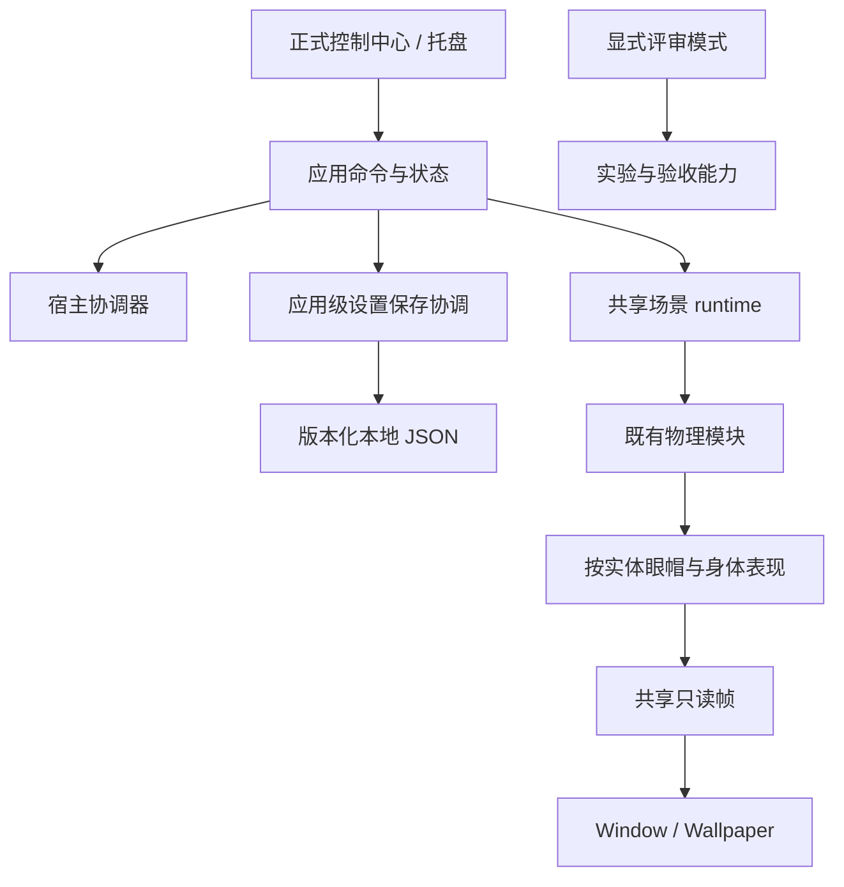

# 第一批：正式桌面入口整合详细设计

> 日期：2026-09-17；状态：用户已回复“确认设计”，本批按下述设计在独立 codex/desktop-entry-integration 分支实施。普通入口已接入新眼帽，用户已确认本批人工验收通过；专项证据边界见[实施记录](../verification/2026-09-17-desktop-entry-integration.md)。后续默认直接从项目打开验收窗口，不再默认提供整个压缩包。下文保留设计时的验收要求。
> 用户已确认先交付单人正式雏形，并同意按“先整合正式桌面入口，再做互动、自主生活、岛和最终交付”的顺序继续。用户随后明确确认本份具体设计，作为本批实施依据；后续互动、自主生活和岛仍按批次另行设计。
> 上位范围：[单人正式雏形规划](2026-09-17-desktop-function-integration-draft.md)。候选执行拆分：[实施计划草案](2026-09-17-desktop-entry-integration-plan.md)。

## 1. 这一批完成后，用户得到什么

用户打开普通 `Dango.Desktop.exe`，即在桌面看到一只具有已认可身体和新眼帽表现的团子。已有拖动、释放、方向移动、下压和跳跃可以直接使用；托盘/控制中心可以隐藏、恢复、切换窗口模式、调整基础设置和退出。用户选择的帽型与基础设置在下次启动继续生效。

这是单人正式雏形的**第一份整合候选**，还不是完整单人版或 Phase 1 已验收。点击回应、抚摸、自主游走/睡醒、真实登岛、低动效策略与最终长驻留/兼容性仍在后续批次。

### 1.1 本批取舍

| 项目 | 本批具体选择 | 理由与边界 |
|---|---|---|
| 场景 | 正常使用固定一只主要团子，复用当前单一 runtime/world | 本地 2/3 体保留为评审和回归，不作为正式用户增删宠物功能 |
| 身体与操作 | 复用已验收外形、物理和拖动/方向控制，不改 native 与参数 | 先证明现有能力能进入统一产品入口 |
| 眼帽 | 普通入口启用已认可附件机制；两种宿主显示同一帧 | 功能启用与评审工具分开，不自动弹眼帽验收面板 |
| 外观 | 身体沿用当前主要团子的杏色；提供已有叶芽/小礼帽/圆顶帽三种帽型 | 不新增素材或身体配色适配；颜色选择与完整 DIY 后置 |
| 新用户默认 | Wallpaper；键盘关闭、方向键方案；交互开启；骨架关闭；叶芽帽 | 复用普通入口和旧设置的默认习惯；不继承 review 的 Window/WASD 默认 |
| 帽子大小 | 新机制采用已认可的 1.35 倍 | 普通入口叶芽与新机制结合仍需本批人工验收，不把旧预览确认自动扩展过去 |
| 保存 | 复用本地 settings 文件，升级到 Schema 4；保存基础偏好、帽型和首次引导标志 | 不引入数据库、云身份或完整宠物档案系统 |
| 位置恢复 | 保留已有普通窗口位置恢复；身体每次启动由现有安全出生逻辑创建 | 本批不保存上次身体坐标、速度或岛上姿态；稳定场景布局随岛批次完成 |
| 分发 | 同一普通入口的 `win-x64` self-contained 便携候选包 | 包内依赖完整，开发者构建时显式给模块输入；用户不需手工复制 DLL |

启动、隐藏、宿主切换、退出和保存错误构成本批日常闭环。未实现能力不放可点击占位按钮；低动效、抚摸、自动睡眠等不能先用设置字段假装可用。

## 2. 事实基线与需要解决的缺口

代码事实以开发提交 `72199ef93febaec88280fb2bd3c27c2fe594f3ca` 为准。本规划工作树停在 `0610355`，不作为实施代码起点。原开发树的历史实验、旧预览与两份受保护库保持原样。

| 已核实事实 | 本批含义 |
|---|---|
| 普通模式、physics review、eye-hat review 已有独立实例与设置目录 | 保留隔离，普通入口继续使用原正式实例身份和 `%LOCALAPPDATA%/Dango/settings.json` |
| `CreateEyeHatReview()` 会创建单体标定世界、推进 240 步并释放，再建立实际 runtime | 可以复用标定算法与数值，但不能直接将“review mode”当正式功能开关 |
| `EyeHatReviewEnabled` 实际表示附件存在，同时影响帽型/大小和面板弹出 | 必须分离“附件已启用”和“允许评审工具”；这是本批主要接线变化 |
| Window/Wallpaper 共享 `StackedDangoSceneRuntime → DesktopPhysicsScene → DangoPhysicsWorld` | 保留一个 owner thread、一个活跃 world 和唯一固定步；宿主只读消费 |
| 当前设置 Schema 3，支持读取 1/2/3 和旧宿主名称迁移 | 增量迁移到 4，不能把旧设置全部当坏文件重置 |
| 当前退出保存失败只写 Debug；控制中心和无控制中心退出各有保存路径 | 统一应用级保存入口，避免新字段被其中一路遗漏；用户必须看到保存失败 |
| `dango_physics_module.dll` 仅在提供 `DangoPhysicsModulePath` 时复制；旧 DLL 无条件复制 | 发布必须有明确模块输入和校验，不依赖 artifacts 偶然存在 |
| 最新记录 Core 37/37、Physics 常规 32/32、Desktop 303/304 | 不是全绿。唯一旧 DLL 导出失败保留；本轮没有重跑测试 |

## 3. 正式用户流程

### 3.1 启动与单实例

1. 普通无参数启动先取得普通单实例身份，读取设置并创建可用的 AppShell/托盘和状态展示能力。
2. 初始化正式附件配置：复用同一受保护模块的 240 步标定流程；标定 world 必须在实际 world 创建前释放。只在启动/明确重建时标定，不在显示、换帽、DPI 或宿主切换时重复执行。
3. 应用本次有效偏好和帽型，按既有映射创建一只团子，再启动当前宿主的唯一更新循环。
4. 新用户首次显示简短控制中心概览，说明拖动、如何开启键盘、托盘隐藏/恢复及退出。后续正常启动直接恢复宿主；重复启动只激活已有控制中心，不再创建场景。
5. 启动失败时保留控制中心和托盘，显示原因与“重试”“切换窗口模式（仅宿主故障时）”“退出”。不能让标定/缺库异常直接穿出应用启动而把所有入口一起关掉。

首次引导标志在概览成功展示并完成保存后生效；不能仅因进程创建就标为已读。正常显示和首次引导不代表完整版本验收完成。

### 3.2 控制中心与托盘

本批复用现有 WPF 壳层，聚焦三个用户区域：

| 区域 | 提供的真实功能 |
|---|---|
| 概览 | 本地运行/隐藏/异常状态；显示/隐藏；恢复团子；退出 |
| 桌面与团子设置 | Wallpaper/Window、已有交互开关、键盘启用与方案、图标上下层级、已有窗口位置、三种帽型 |
| 帮助与诊断 | 可复制的安全故障说明、设置保存状态及重试；已有隐私受控诊断导出 |

正式导航不展示多体增删/选择、骨架、完整物理参数、表情指令面板和验收清单。评审入口保留这些能力及原验收草稿，不删除底层接口、旧预览或历史测试。普通操作中不出现尚未实现的“抚摸”“睡觉”“低动效”按钮。

权限只是本地 UI 能力划分，不涉及业务授权：AppShell 明确传入 `Product` 或 `DeveloperReview` 的界面能力；不能根据“是否有新附件”推断是评审模式。日常诊断保持可达，不与实验页一起全部隐藏。

### 3.3 隐藏、关闭、恢复和退出

- 关闭控制中心只隐藏该窗口；关闭普通场景窗口只隐藏场景。托盘继续可达。
- 隐藏/最小化按既有宿主语义清除输入、暂停步进；显示时不补算隐藏期间时间，不恢复按住键或拖动。单实例再次启动打开控制中心，不暗中重置团子。
- 切换宿主复用原 world、实体 ID 和附件状态，继续既有切换确认与回滚；移除焦点/捕获时立即取消操作。WorkerW 失效进入明确隐藏/不可用状态，用户显式切换 Window，不自动抢焦点打开场景窗口。
- “恢复团子”复用已有 Reset 语义：清操作/附件瞬态并回本次出生状态，保留帽型与用户设置。它不等于恢复全部设置，也不等于新建宠物。
- 退出沿用当前一次退出确认；先尝试保存、取消输入/回调，再释放宿主和 runtime。保存失败应在仍可操作的控制中心/退出流程显示，不只能写 Debug；用户可重试或明确选择不保存退出。不能无限阻止退出。

## 4. 模块对接设计

### 4.1 初始化与运行态

建议 runtime 提供明确的初始化结果与只读运行状态，AppShell 消费其结果。命名可在实现中精简，但必须表达以下契约：

| 契约 | 责任与约束 |
|---|---|
| 正式附件配置 | 固定已认可参数与三种帽型资源；复用标定实现；不包含界面模式、设置路径或单实例名称 |
| 初始化结果 | 成功后才能进入 Running；缺库/错误架构/ABI/标定失败带稳定错误类别；中途分配必须释放 |
| `AttachmentsEnabled` | 只表示附件消费是否可用；不决定弹窗、开发导航和存储目录 |
| AppShell 启动模式 | 决定普通/评审实例、设置路径与界面能力；普通模式在身体与附件都正常时才显示完整可用 |
| 帽型应用命令 | 建议 `TryApplyHatPreset(id)` 返回明确结果，并更新 runtime 的 `CurrentHatAppearance`；两宿主继续只读消费 `DisplayHatAppearance/DisplayHatSize`，不推进物理、不重新标定 |
| 应用状态快照 | 分开显示运行状态、宿主状态、附件故障和保存状态；不能用“请求已接纳”当“已保存”或“已生效” |

初始化仍在所属 UI 线程进行有界工作，使用当前 240 步算法与固定步长，不为启动速度调整物理参数。不引入后台物理线程；记录实际标定耗时，如响应不满足现有宿主要求，再评审分批调度，不以更改步数绕过。

推荐先将控制/状态入口建立，再进行可能失败的初始化；不能在 `DangoApplicationHost` 构造一开始调用会抛出的 review factory，使错误界面也无法创建。重试只重试失败初始化，须先释放其残留资源；已活跃世界不能因打开设置而重建。

未初始化/不可用时，宿主控制对象仍须提供有效状态、当前偏好和退出/重试能力；不能catch构造异常后把runtime留空，再让控制中心刷新触发空引用。初始偏好可先保存为待应用值，真正初始化成功后统一应用；刷新概览或打开诊断不得隐式创建world。重试成功发布Running状态，由同一控制中心刷新。

正式帽型接口替代把 `ReviewHatAppearance` 当公共产品设置的做法。普通与评审都通过各自应用实例的同一受校验表现接口设置帽型，界面模式与存储根目录仍独立；评审面板不再用“存在附件”推断普通应用应该弹出。无新附件的历史对照路径仅用于明确的回归，不决定普通产品的帽型或大小。

### 4.2 保持已认可的表现

身体算法、参数版本 1、16 节点、单/双/三体能力和 3% 接触规则不改。保留重绘眼形、130 ms 眨眼、向左时右眼 7/左眼 5.25 DIP（向右镜像）、眼距收缩/释放弹回、真实跳跃上下眼动、1.35 倍帽子及急停惯性。

附件仅在成功物理步后推进；隐藏/失败冻结；重置更换 generation，移除使旧命令失效。帽子始终附着且不独立碰撞。三个帽型使用已有 `HatAppearance`/几何；本批不新增 BounceHat 或调整已有眼帽数学。

正式单人 UI 只操作主实体，但 runtime 的按 ID 路由和多体回归保留。不能为了收敛界面把物理容量改成 1，或者把数组第一项写成以后所有控制命令的身份。

### 4.3 错误边界

| 错误 | 用户看见什么 | 运行处理 |
|---|---|---|
| 新模块缺失/架构或 ABI 错误/首次标定失败 | 场景不可用，原因可识别，重试和退出可达 | 不创建正常场景；释放临时资源；不静默启动旧 DLL 或把旧眼帽当新能力成功 |
| 物理运行失败 | 保留安全画面并显示错误，可显式重置/退出 | 沿用锁存、清输入、停止普通推进；不在循环里无限重试 |
| 单实体附件运行失败 | 显示附件异常，身体能力与附件状态分别报告 | 沿用该实体附件冻结，不重置物理；用户可显式恢复，不标全正常 |
| 宿主切换失败 | 状态回滚或安全隐藏，提供已有恢复入口 | 不重复 world，不自动弹出抢焦点窗口 |
| 设置写入失败 | “本次已应用，但未保存，下次启动可能恢复旧设置”，提供重试 | 当前会话可继续；旧文件完整；不反复执行已经成功的宿主命令 |

## 5. 基础设置与保存契约

### 5.1 Schema 4 最小变化

继续使用现有设置文件，不新建宠物数据库/档案目录。沿用已有字段及校验：控制中心尺寸、显示模式、Window placement、对象层级、键盘偏好、历史骨架字段。新增下列候选字段：

| 字段 | 缺失默认 | 语义 |
|---|---|---|
| `interactionEnabled` | `true` | 本地团子区域是否接收既有交互，不保存任何输入内容 |
| `hatPresetId` | `sprout` | 封闭值 `sprout` / `top-hat` / `bowler`；持久化稳定字符串，不写枚举序号 |
| `introSeen` | `false` | 是否已展示本批简短操作说明 |

Schema 1/2/3 迁移保留已存尺寸、宿主、层级、键盘与场景窗口位置；旧 `WorkerW/Overlay` 映射 Wallpaper 的既有行为不改。旧骨架偏好作为兼容字段原值保留；Product模式应用设置时显式强制运行态骨架关闭，不能沿用当前无条件应用字段的路径。保存时保留该兼容值而非用当前false覆盖它；DeveloperReview仅消费其独立文件里的骨架值。测试须包含旧Schema3骨架为true的普通启动。

未知帽型在受支持 schema 中回叶芽并提示，不使整个有效设置失效；未来未知 schema、无法解析/读取的文件进入保护模式：使用安全默认运行，**不在退出时覆盖原文件**。恢复写入需用户使用明确的设置恢复入口；先留存原始字节副本，再创建新的有效设置。无权限或备份失败则继续保护原文件并报告。

迁移采用“读取并验证 → 保留原文件副本 → 原子写入新版本”的顺序，不只因为打开程序就删除或清理旧设置。备份放在本地应用数据目录，使用唯一文件名，不写入仓库或诊断导出。

### 5.2 单一保存责任

AppShell 持有一份当前有效偏好和保存状态，协调统一捕获/保存；控制中心和托盘提交命令，不各自重建不完整 settings 对象。复用现有 store 和原子写入器，不为此新增通用框架。

命令顺序：校验 → 应用到 runtime/宿主 → 确认当前状态 → 保存。应用失败则偏好不提交；保存失败则保留已应用状态并标“未保存”。离散开关和帽型在成功应用后保存；窗口尺寸/位置连续变化可约 300 ms 合并，关闭/退出时刷出最终值。该时间是本批建议值，不改变物理时钟。

不保存显示/隐藏临时状态、当前按键/拖动、物理节点/速度/句柄、眼帽弹簧相位、token/generation、pendingSpawns、故障帧和评审数量。正常启动显示团子并恢复偏好；身体从安全出生点创建。未实现的低动效或自主行为不添加假开关。

## 6. 包和验证环境

普通包采用 `dotnet publish` 的 Release / `win-x64` / self-contained 输出；使用一个新的专用发布脚本显式接收已验收模块路径与本次输出名，不改旧 review 脚本去覆盖历史产物。

| 受保护内容 | 固定验证值 |
|---|---|
| 原 `dango_box2d.dll` | SHA-256 `6712D66ECEF9588123CAFCD868455080598B5B58711A698FB8AF022A0CDA191A` |
| 已验收 `dango_physics_module.dll` | SHA-256 `00FF064A9A1A4DB67712403A8D01F19845A9EDF6B582D5FCA7CB9D0B567EF69C` |

开发者路径只作为本地脚本参数，不能硬编码个人目录进项目。脚本先验证输入，再发布到全新目录，核验两库字节、许可证/依赖清单和包内相对路径，生成不含本机路径的包清单。输出目录已存在则拒绝，不清理、不覆盖、不停止进程。本批不重建 native；输入不存在或哈希变化即停止打包并报告。

当前受保护统一库存在于本地验收产物，并非纯净 Git checkout 自足依赖。本批显式输入可形成完整用户包，但不能宣称已解决从零重建该产物或 CI 分发问题。后续如需重建，单列等价验证和产物交付方案，不能替换旧库修绿。

正式候选的人工检查需要普通无参数入口和正式行为。建议用隔离 Windows 测试用户/测试环境，保持相同单实例/设置规则，避免覆盖日常用户设置。已有 review 入口用于原基线回归；仅用 review 通过不能替代普通入口检查。若没有隔离桌面环境，相关项标未验证，不自动搬移/删除个人设置或关闭旧预览。

**已知 Desktop 红灯保留。** 可以构建并评审明确标记的内部候选；在 `SharedSelfWorldExportsAreAvailable` 的契约归属完成独立审阅且必要门禁满足前，不把该包称全绿正式交付。仅复制新模块不能让旧导出检查变成通过。

## 7. 可审阅决策与不变边界

| 决策 | 推荐与替代方案 | 后果 |
|---|---|---|
| 接入新眼帽 | 分离功能配置/启动模式；不直接把普通程序改成 review | 增加窄的启动配置接线，保留普通数据与界面 |
| 标定 | 复用固定模块的运行标定，暂不缓存人工生成快照 | 每次冷启动有有界开销，但不会错用旧标定；必须验证耗时与释放 |
| 外观 | 先只开放已有三帽，身体颜色沿用主实体 | 可以验证外观保存，不扩大到配色/DIY 系统 |
| 设置 | 现有 Schema 3 演进为 4，AppShell 统一保存 | 需迁移/写入失败测试；避免两条保存路径丢新字段 |
| 低干扰 | 本批提供可靠隐藏；低动效行为后批专项设计 | 不能称完整单人低动效已交付；不直接关闭承担真实运动的物理 |
| DLL 问题 | 保留失败并单独核实；不覆盖库或默删检查 | 当前整合候选与最终正式交付状态分开 |

本批不改真实身体动力学、完整动作状态机、岛几何/物理、网络/账号、渲染后端、依赖版本或旧预览。当前身体位置与早期 Core 权威设计的差异仍记录在总草案，随动作/岛批次形成专项职责设计；本批不偷偷接回旧轨迹。

## 8. 来源与设计编写时状态

以下路径相对于开发基线 `72199ef`，不是本规划工作树中的旧同名代码：

- `src/Dango.Desktop/App.xaml.cs`、`AppShell/DangoApplicationHost.cs`：实例、目录、启动与保存路径。
- `src/Dango.Desktop/Rendering/Dango/StackedDangoSceneRuntime.cs`、`AttachmentReviewPanel.cs`、`DangoHostFrameBinding.cs`：标定、附件/评审耦合、帽型、颜色与同帧显示。
- `src/Dango.Desktop/AppShell/ControlCenter/ControlCenterWindowSettingsStore.cs`、`src/Dango.Desktop/Verification/VerificationSessionStore.cs`：Schema 3、校验/迁移、原子写入。
- `src/Dango.Desktop/DesktopHost/KeyboardControlSettings.cs`、`DesktopHostCoordinator.cs`：默认键盘与宿主切换。
- `src/Dango.Desktop/Dango.Desktop.csproj`、`eng/run-eye-hat-review.ps1`、`eng/run-physics-host-review.ps1`：模块复制和历史隔离构建。
- `docs/verification/2026-09-17-worktree-checkpoints.md`、`docs/verification/phase-1-eye-hat-motion.md`、`docs/development-workflow-v0.1.md`：当前证据、认可范围及工作阶段。

设计编写轮（确认前）仅只读审计并写本设计及计划草案；未构建、测试、启动、停止或清理预览，未操作设置/数据库，未提交、合并、推送或部署。所有未来验收均尚未执行。

设计确认后的实施与实际验证见[本批记录](../verification/2026-09-17-desktop-entry-integration.md)。
