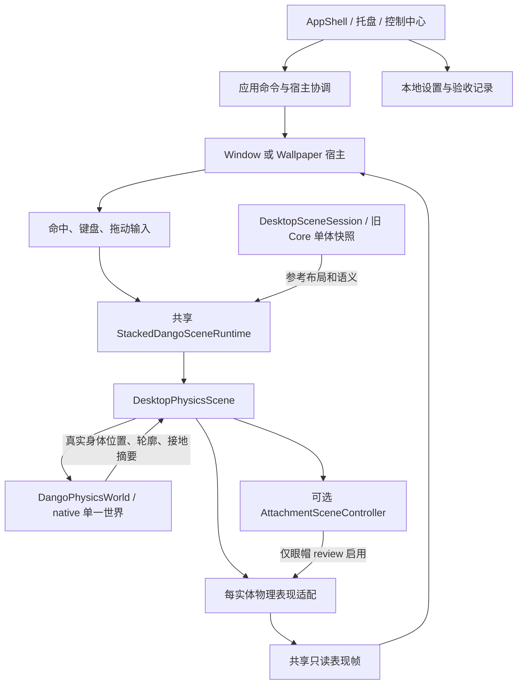

# Dango 单人正式雏形：功能与模块对接草案

> 日期：2026-09-17。范围已确认：“先交付单人正式雏形”。第一批正式入口已独立实施并获用户人工验收通过确认；后续默认直接从项目打开验收窗口，不再默认提供整个压缩包。其余详细功能、交互与接口方案仍供审阅。
> 推进顺序已确认：先整合现有正式桌面入口，再补互动、自主生活、岛和最终交付。第一批已细化为[详细设计](2026-09-17-desktop-entry-integration-design.md)与[实施计划草案](2026-09-17-desktop-entry-integration-plan.md)，现已获确认；具体实施进展见[第一批记录](../verification/2026-09-17-desktop-entry-integration.md)。
> 本轮只读盘点和编写草案；没有启动预览或服务，没有修改代码、测试、DLL、既有设计和阶段状态。
> 事实来源：开发分支 `feat/p1-004-box2d-soft-body`，提交 `72199ef93febaec88280fb2bd3c27c2fe594f3ca`。本文所在独立规划工作树起点为 `0610355`，是 Phase 0 整合状态，不能用它缺少的代码判断当前功能缺失。

## 1. 先看用户最终要得到什么

Dango 的产品目标仍是：自己的团子安静地生活在桌面上，也能和熟人的团子待在同一个房间。身体、眼睛和帽子服务于这份陪伴感；桌面宿主、控制中心、账号与服务器负责让它可靠、可操作、可共享。

**本版目标已确认：先交付可以持续使用的单人正式雏形。** 一个用户、一只主要团子、一个本地桌面场景，从统一正式入口完成日常使用，保存必要状态，处理启动/退出/异常，并能用一个可分发包交付。隔离预览中的效果要进入这条产品链路；预览窗口集合不是本版成果。

本版不包含账号、好友、房间、多人同步、网络服务或数据库。多人仍是完整产品方向，按原 Phase 2/3 顺序后置；单人选择不等于删除完整 v0.1 需求，也不等于批准本文所有动作细节或代码实施。分清下列层次：

| 层次 | 用户能得到什么 | 对应已有计划 |
|---|---|---|
| 技术验证增量 | 验证物理、眼帽、宿主和同步等单项；可以隔离运行 | 是输入材料，不是本版交付方式 |
| 本版单人正式雏形 | 单一产品入口、完整单人操作、本地档案/设置保存与恢复、可分发 | 已选定交付方向；整合现有能力并补齐产品流程 |
| Phase 2 同步证明 | 两个真实客户端、临时身份/房间、有序事件与恢复 | 是联机技术前置，不能凭内存临时房承诺持续使用 |
| 完整 v0.1 产品首版 | 账号、好友、房间与权限、家、情侣、有限 DIY 和多人陪伴等已批准范围 | Phase 3–5 逐步形成；本版若先交子集，未交项保持未完成 |

本版建议围绕六件事完成：正式入口；团子身体/眼帽；基本互动与自主陪伴；一个岛的真实上下岛；设置与安全恢复；可重复打包和真实桌面验收。具体交互方式、岛物理方案和低动效机制仍需在下一步设计中审阅。

当前按批次推进：先定清现有身体/眼帽进入普通入口的设计与验收，再逐批细化互动、自主生活和岛的用户流程/模块契约。无需先做完整表情库或一次写完所有动作细节。不把“旧 DLL 门禁处理”自动提升为本次首要任务，也不因重新讨论动作而恢复搁置草案的实施授权。

标记约定：**事实**来自当前代码或有效记录；**历史**只说明当时情况；**建议**是本草案的取舍；**待定**需后续讨论。用户对已实现部分的人工认可继续有效，不重复请求批准。

## 2. 桌面应该提供哪些功能与入口

### 2.1 从打开到退出的日常体验

下表中的入口布局属于建议，已有能力见第 3 节。它不是界面设计已获批准的声明。

| 用户场景 | 建议入口与操作流程 | 用户能理解的结果 |
|---|---|---|
| 第一次体验 | 获取分发包 → 正式入口启动 → 必要引导 → 出现主要团子 → 学会拖动和找回控制中心 | 无需登录和连接服务；不要求命令行开关、手工复制 DLL 或打开验收窗口 |
| 日常陪伴 | 默认桌面模式驻留；不操作时待机、少量自主移动、休息 | 不抢焦点、不持续追鼠标、不制造照料压力；行为节奏待审 |
| 逗团子 | 在团子轮廓内点击、拖起、放下；明确入口进入抚摸 | 每次操作有对应反馈；点击和抚摸不能破坏已有抓取手感 |
| 主动控制 | 开启键盘控制 → 按既有焦点/输入规则操作主要团子 → 方向键或 WASD 移动、下压和跳跃 | 正式单人流程不要求先做多体选择；失焦/取消后不继续按住，不影响正常打字 |
| 在岛上休息 | 请求去岛上 → 接近 → 爬上 → 停留/休息 → 下岛 | 身体真正落在岛面；不是只把显示坐标移到岛上 |
| 暂时专心工作 | 托盘或控制中心 → 隐藏；需要时恢复 | 隐藏停止本地步进，恢复不补算积压时间 |
| 减少干扰 | 控制中心 → 降低动画；可另讨论“安静陪伴” | 降低视觉动效与限制自主移动是不同能力，不共用含糊开关 |
| 改外观 | “我的团子” → 少量预设颜色/帽子 → 预览 → 保存/恢复默认 | 本版建议先做有限选择且重启保留；完整体型/柔软度 DIY 后续完善，不暴露开发调参面板 |
| 切换显示方式 | 设置 → 桌面模式或普通窗口；桌面模式再设对象相对图标的层级 | 同一场景继续存在，不重生一批团子；窗口关闭是隐藏场景 |
| 出现问题 | 清楚显示功能不可用及原因 → 可显式重试/重置或退出；按需打开诊断 | 不把占位画面、旧算法或一次 Toast 当作操作成功 |
| 结束使用 | 托盘/控制中心 → 退出 Dango | 保存本地偏好/稳定档案，释放宿主、输入捕获、计时器和物理世界 |
| 下次继续 | 再启动 → 恢复用户偏好、团子身份/外观和有效场景 → 错误时显示恢复入口 | 不必每天重新布置或重新选帽子；恢复安全状态，不重播上次尚未结束的拖动 |

**本版控制中心建议分工：**“概览”显示本地运行状态与隐藏入口；“我的团子”容纳有限外观和主动互动；“设置”容纳显示、输入、动效与恢复；“帮助/诊断”提供可识别故障和诊断。账号、房间、好友不出现在本版日常导航中。现有壳层、托盘、命令反馈和设置机制可复用；实验与验收保留开发入口。

**正式入口收敛要求：**普通用户启动同一个 exe，就得到这一版支持的身体、眼帽、互动与设置。`--physics-host-review`、`--eye-hat-review` 和原生实验继续作为开发验证工具，不能成为用户启用核心功能的必要步骤。调参、验收清单和三个本地团子的诊断控制默认不进入正式日常导航；诊断入口可保留在帮助中。

当前的添加到三只、删除、骨架和物理参数查看是本地验证能力。产品基线是一名用户拥有一只主要团子，不能直接把“添加团子”按钮解释成正式账号可以无限创建宠物。建议保留为开发工具，直到另有产品决策。

### 2.2 本版必需与后续完善

下表是正式雏形的**建议边界**。P1 已批准的岛/交互/兼容门禁继续保留；不因本表中的取舍自动改动阶段计划。精简本版内容，是交付子集，不是删除完整首版需求。

| 功能组 | 本版单人必需功能建议 | 后续完善或未来范围 |
|---|---|---|
| 团子身体 | 认可的轮廓、移动、跳跃、拖放、落地与接触；一只主要团子的稳定输入 | 有界体型/柔软度 DIY 后续；自由上传不进完整首版 |
| 眼睛与帽子 | 已认可眼形、眨眼、面向、跳跃眼动、帽子跟随进入正式入口；少量预设保存 | 独立 BounceHat、更多表情/帽子后置；按本版启用能力验证安全预算 |
| 基本互动 | 点击、抚摸、拖放、方向控制、取消与恢复 | 复杂手势、玩具、投球；多人权限及共享反馈后续 |
| 自主行为 | 待机、短移动、睡醒、岛上/岛下基本生活；可降低干扰 | 多人贴贴/群体动作后续；不做 AI 和重养成 |
| 岛与场景 | 一个真实岛、上下岛、安全边界、两宿主坐标一致；布局和安全位置恢复 | 多家具、布局编辑和共享场景后续 |
| 桌面承载 | Wallpaper/Window、图标层级、穿透、焦点、隐藏/恢复/退出；统一入口 | 跨平台不进完整首版；联网生命周期以后接入 |
| 设置与档案 | 本地版本化偏好、主要团子有限外观、安全布局、恢复默认和故障反馈 | 自启/自动更新可后议；不为静音开关先造音频系统 |
| 账号与多人 | 本版无账号/房间/服务端；本地档案可恢复，不宣称云身份 | Phase 2 双客户端同步；Phase 3 账号、好友、房间/家/权限与持久化 |
| 分发与持续使用 | 版本化 self-contained 包、完整 native/许可证、数据与程序分离、更新保留和损坏回退、干净环境验证 | 自动更新、商店/公网发布和云资源均后续另列 |

“可后置”不等于从已批准产品首版删去。特别是账号、房间、好友和多人陪伴，仍属于最终首版闭环。[S2、S3]

## 3. 功能现状矩阵

### 3.1 先说明证据能证明什么

- **最新自动记录**：2026-09-17 独立导出树 Core 37/37，Desktop 303/304（已包含连续添加占位修复）；Physics 常规 32/32，排除 `DangoPhysicsStabilityTests` 长测。Desktop 唯一失败为旧 DLL 缺少 `dango_box2d_self_bodies_create`。这些是已有记录，本轮没有重跑。[S1]
- **人工认可**：单/双/三体模块、物理宿主接入分别获认可；2026-09-17 眼帽双宿主隔离预览获认可。认可不扩展为第二种 DPI、长驻留、全部故障和兼容矩阵均通过。[S1、S5、S6]
- **普通入口**：源码已复用 `DesktopPhysicsScene → DangoPhysicsWorld` 的宿主接线；新模块只有在构建指定 `DangoPhysicsModulePath` 时由项目文件复制。因此代码可达不等于任意普通构建输出都能直接运行。[C1、C2]
- **眼帽入口**：新机制仅通过 `--eye-hat-review` 开启，普通入口仍为旧表现分支；review 设置、单实例标识和验收草稿独立。[C1、S6]

| 功能 | 已有实现与入口 | 普通入口情况 | 自动验证/人工认可 | 缺口与依赖 |
|---|---|---|---|---|
| 单体身体、移动、下压、跳跃、拖放 | 新物理模块和桌面消费；Window/Wallpaper 均有路径 | 已接线；依赖输出有新模块 DLL | 模块/宿主自动记录和各自人工认可 | 普通发布依赖声明与可重复交付需收口；完整异常矩阵未验证 |
| 本地 1/2/3 体、接触/承重、选中/移除/重置 | 同一 world；稳定 ID；连续添加预留出生占位 | 可通过控制中心调用，容量上限 3 | 对照、生命周期及添加回归；已认可自然滑落 | 不保证永不滑落；不是多人，也没有 6/12 体能力证明 |
| 身体外观和颜色 | 已认可的无描边软体外观、固定颜色槽 | 已有显示路径 | 现有视觉/渲染与人工证据 | 不等于完整外观编辑或账号外观持久化 |
| 双眼与自然帽子 | 独立眼状态、130 ms 眨眼、面向、真实跳跃眼动、1.35 倍帽子急停惯性 | 新机制默认关闭；旧表现仍在 | 新眼帽三路物理等价/生命周期；双宿主预览人工通过 | 普通入口切换未做；第二 DPI/长测/完整故障矩阵未补 |
| 独立弹帽、组合预算、降低额外动效 | 契约/局部机制不代表完整消费 | 不具备完整产品能力 | 没有整体完成证据 | BounceHat、完整组合预算和低额外动效明确未完成；应单列取舍 |
| 点击、抚摸、完整反应 | 有 Core 状态/历史控制器及搁置设计 | 未形成新物理路径下完整闭环 | 不能用枚举或旧轨迹测试证明新交互完成 | 手势识别、抢占、取消、反馈；原草案阈值均未获批 |
| 自主待机、游走、睡醒 | 旧控制器可参考，新的动作调度未完整接入 | 不能算可用自主陪伴 | 无本轮完整行为验收 | 统一按实体的动作输入、支撑反馈、行为时钟和中断策略 |
| 岛的显示 | Core 岛几何和宿主占位显示/层级 | 可显示岛 | 既有宿主层级历史验收 | 可见岛不等于物理平台 |
| 真实登岛、岛上承重、下岛 | 模块没有平台/攀爬 API | 未实现完整能力 | 无真实岛行为通过证据 | 平台几何、支撑 ID、速度反馈、攀爬机制和坐标契约先设计 |
| Window/Wallpaper 与图标层级 | 共享场景/runtime，Window、WorkerW、对象上层、输入代理 | 已有切换/配置 | P1-003/P1-006 已有人工认可；新物理/眼帽分别有隔离认可 | 新旧证据覆盖不同；新组合的 DPI、Explorer/显示器变化矩阵未齐 |
| 控制中心、托盘、单实例 | 统一 AppShell；显示、交互、模式、键盘、数量、退出、验收工具 | 已有 | P1-002A 历史门禁/人工认可 | 普通用户信息架构、社交入口尚需后续设计 |
| 本地设置 | JSON 校验/回退/保存；宿主、输入、层级、窗口位置等 | 已有；review 独立保存 | 有设置和迁移测试/历史验收 | 不保存共享房间事实，也不是团子完整状态持久化 |
| 静音、降低动画、安静陪伴 | 产品要求/候选方案；当前新眼帽低动效未完成 | 不算完整可用 | 不能用 UI 占位或偏好字段代替效果验证 | 静音随实际声音接入；低动效需和现行物理责任一起明确；安静陪伴是建议 |
| 故障、诊断、恢复 | 缺库/ABI/运行错误明确；安全帧冻结，显式重置/退出；诊断与验收导出 | 有处理路径 | 定向自动覆盖；全矩阵未验证 | 旧 DLL 导出失败保留；普通发布、主机兼容和长驻留待验证 |
| 性能、安装和最终兼容 | 有发布/诊断基础与历史 smoke | 不是发布验收通过 | 已有隔离发布成功；P1-005/P1-007 未完成总门禁 | 1/6/12 渲染压力、Win10/11、双屏等实测；安装更新不从便携包推定 |
| 账号、房间、好友、家、情侣 | 产品/服务端设计已定主要规则 | 当前无正式实现 | 无集成/双客户端/人工同步验收 | 服务端、协议、会话、共享身份、权限与持久化全部是后续工作 |

**Git 与历史边界：**`f18bc79` 是物理模块检查点，`c709fb7` 是桌面与眼帽检查点，`72199ef` 是记录整理；均未合并 main，未配置远端。源工作树保留的 1 处 CMake 改动和 25 个源码文件是历史实验，不自动纳入运行基线。旧对照 DLL 曾受损的历史说明仍保留，现有复验没有重新认证原始对照产物。[S1]

## 4. 现在模块怎样接在一起

### 4.1 当前实际调用关系

该图不意味着已存在完整应用动作层或服务器。宿主有各自计时器，切换/隐藏决定哪一条活跃消费；同一场景必须每固定步只推进一次 world。不能让两个可见表面各自建立世界，或因绘制眼帽再次 Step。[C1–C4]

### 4.2 状态归属、现有契约和缺口

| 模块 | 应负责的状态和工作 | 可复用现有能力 | 待补接口或边界 |
|---|---|---|---|
| UI 与输入适配 | 局部命中、按键、捕获、当前选择与用户操作；输出意图 | Window 输入、WorkerW 代理、失焦/Esc/隐藏取消 | 点击/抚摸会话；屏幕点转场景意图；不能直接写业务结果 |
| AppShell/应用用例 | 显示、退出、模式切换及真实命令结果；协调场景生命周期 | `ApplicationCommandController`、`DangoApplicationHost`、回滚机制 | 统一实体动作请求与完成/取消结果；未来连接/登录/入房用例 |
| Core/动作状态 | 与 WPF/native 无关的动作许可、任务和场景语义 | 坐标、状态类型、资产契约、附件意图 | 当前 `SceneSnapshot` 仅一个 Dango + 一个 Island；未来稳定多实体共享快照；不能复制旧位置轨迹与物理双重积分 |
| 场景运行时 | world、ID 映射、选择、暂停、物理时钟、表现状态的生命周期 | `StackedDangoSceneRuntime`、`DesktopPhysicsScene`、pendingSpawns | 每实体经仲裁的输入；本地 ID 与网络身份映射；能力与错误查询 |
| 物理模块 | 当前本地运动、轮廓、真实接触与约束；资源和失败码 | `Create/Add/Remove/Step/Reset/Dispose`，容量 1–3，稳定 ID | 平台/攀爬、支撑对象和速度向量；未来权威目标跟随/纠正；不能接收任意未鉴权远端状态 |
| 眼帽表现 | 按实体独立左右眼/帽子状态、token/generation/序号；只消费成功身体帧 | Core 附件意图 + scene/router/motion；宿主共用一帧 | 普通入口产品化、低动效、独立弹帽/预算；接纳请求不等于动作完成 |
| 渲染与宿主 | 只读画面、物理↔逻辑像素映射、层级、DPI、图标优先、输入穿透 | WPF 几何、Window/WorkerW、上层对象显示 | 新功能端到端验收；物理位置不能靠画面偏移掩盖接触/同步错误 |
| 本地持久化 | 非敏感用户偏好、窗口位置；独立验收草稿 | JSON 存储、版本迁移、错误回退 | 正式外观缓存/会话凭据另定；不保存正在拖动、鼠标轨迹或 native 句柄 |
| 未来服务器 | 身份、授权、房间规则、共享位置/动作、事件顺序、长期事实 | 已批准技术与领域基线；无当前可复用服务实现 | 协议 v0.1、权威房间、确认/拒绝、快照/重连、事务和限流 |

### 4.3 现有底层数据契约

- `DangoEntityId(int)` 是一个本地物理世界的实体标识，不是账号 ID 或全球唯一宠物身份。
- `DangoPhysicsInput` 包含实体 ID、水平 `[-1,1]`、下压 `[0,1]`、单帧跳跃边沿、拖动开关和世界坐标目标。
- `DangoBodyState` 提供 `CoreX/CoreY`、轮廓、质心、面积、最大速度、接地计数/标志及抓取节点；**尚没有支撑物 ID 和完整速度向量**。世界 X 向右、Y 向上；桌面映射再转换成向下的屏幕 Y。
- `DangoPhysicsFrame` 带 `ErrorCode`；不是每次调用都成功。当前一轮场景只产生一次 world step，所有身体和附件共用该次结果。
- 眼帽候选已消费 `SetGaze`、`SetEyes`、`Blink`、`SetHatSlide`，启用相应能力的路由也消费 `PulseHat`；不能将这些重新列为从零实现。独立 `BounceHat` 仍不支持，完整组合预算和降低额外动效未完成。`Accepted` 只表示接纳，完成/取消事件另行消费；不支持能力明确返回 Unsupported。
- 隐藏、暂停或失败时不补算眼帽历史；重置更新 generation，移除使旧实体命令失效。Window/Wallpaper 只读显示相同结果。[C2–C5]

保留的视觉数值：130 ms 眨眼；向左时右眼 7、左眼 5.25 DIP，向右镜像，眼距缩小并在释放后弹回；跳跃眼动来自实际身体 Y 变化；帽子 1.35 倍并保留急停惯性。帽子始终附着，是表现层，不增加独立掉落/碰撞规则。[S6]

## 5. 下一步对接最需要解决的责任边界

### 5.1 本版动作状态与本地物理位置，兼顾未来权威位置

**事实：**当前宿主仍持有旧 Core 单体快照，主要用于参考布局和部分语义；新桌面身体位置则来自 `DangoPhysicsWorld` 的 `CoreX/CoreY`。现有代码没有把这份物理位置回写成 Core 权威快照，也没有提供完整的“按服务端位置/动作驱动物理并纠正”的接口。[C2–C4]

**已批准方向：**ADR 0005 要求 Core 提供权威姿态与动作，Box2D 负责表现；服务端设计要求共享位置、拖动和互动结果由服务器裁定。[S4、S7]

**推断：**本地物理原型和早期权威表现设计尚未完全接合。不能直接上传本机物理位置并宣布它是房间事实，也不能只给现有 runtime 加网络监听就称对接完成。模块提取、真实动态核心、故障冻结和低动效方面还存在文档演进差异，需要在联机设计中明确取舍并更新相应 ADR；本轮不替用户批准新责任分配。

**本版需要收口的部分：**明确单人动作状态如何消费实际运动/支撑反馈，稳定布局怎样初始化物理世界，以及旧 Core 轨迹如何避免与当前物理双重积分。建议在单人设计中记录其与 ADR 的差异并审阅；不以实现服务器权威位置为本版前置，也不因联机后置而忽略本地状态不一致。

**建议：**保留当前本地手感作为回归样本。在 Phase 2 协议/驱动设计中，先定义服务器裁定的逻辑位置、支撑关系、动作时序和最终结果，再隔离验证客户端如何跟随、预测和纠正；软体轮廓与眼帽惯性留本地。若这一路无法保留已认可的碰撞/拖放效果，再评估替代方案及其 ADR 影响，不静默退回旧运动学轨迹，也不默认把现有 Windows native 模块搬到服务器。

### 5.2 岛：同一份几何，不是三个各画各的矩形

**缺口：**Core 有岛快照，宿主能显示岛，但新模块没有真实岛平台接口。可登岛闭环需要统一平台 ID、几何、可抓边、顶面支撑区及版本；显示、命中、导航和物理都应使用同一份定义。

**建议职责：**Core/场景定义岛的语义与目标；物理契约提供真实平台、接触反馈和必要的可取消攀爬能力；动作层决定何时请求/取消；渲染只画结果。用户拖起、平台失效、视口不可达、动作超时都要有明确返回状态。

搁置草案中的“限力攀爬约束”、摸摸模式及时间阈值只能作为备选材料。尚未获准选择其力学方案，更不能把改视觉坐标作为真实登岛成功。[S8]

### 5.3 应用动作层：让手动、自主和远端请求汇合

**建议的动作流程：**输入/按钮/自主决策产生请求 → 应用动作层按实体检查当前状态和优先级 → 产生唯一身体意图与可并行表情意图 → 固定步推进 → 根据真实结果报告 Active/Completed/Cancelled/Failed → UI 显示结果。

身体任务和表情应能并行：正在眨眼不应覆盖正在下落；新自主行为不能直接修改 UI 坐标。按实体调度也不应通过偷偷改变当前选中对象来控制第二只。拖动、重置、隐藏、失焦、切换宿主、移除和故障必须统一取消，不能各层保留半个动作。

未来联网时，共享任务由服务器确认/调度，客户端自主表情仅限不改变共享语义的装饰效果；客户端不能各自决定一次靠近、贴贴或群体动作。正式房间里的宠物删除/重置也不能沿用本地实验按钮直接生效。

### 5.4 生命周期与故障处理

第三列仅供后续联网设计参考，本版只实现并验证本地生命周期，不新增连接或房间状态。

| 事件 | 当前能力/应保持的规则 | 联网前需补的语义 |
|---|---|---|
| 启动 | 加载并校验设置；建立宿主与唯一 runtime；加载失败明确可见 | 身份会话与进入房间不混同宿主启动；网络不可用不能假报在线 |
| 选择/拖动/取消 | 稳定 ID；清理捕获和持续按键，避免转交给其他团子 | 拖动请求的拥有权、租期/结束条件和冲突拒绝 |
| 隐藏/恢复 | 当前单机暂停，不补算隐藏时间 | 建议仅隐藏本机渲染、保留连接；恢复先追平权威状态。需与服务器 hidden 字段含义对齐 |
| 宿主/DPI/显示器变化 | 迁移映射并清输入，复用 world；容纳不足明确提示 | 本机窗口变化不能改整个房间布局；统一房间视图映射待设计 |
| 单只附件异常 | 冻结该实体附件并报告，不重置物理 | 不影响其他用户房间事实；可恢复表现层 |
| native 失败 | 保留最后安全帧或明确不可用占位，停止输入；显式重置/退出 | 断开本地物理不等于销毁房间宠物；根据权威快照重建表现 |
| 网络断线 | 当前尚无网络状态 | 区分连接中、已连接、短断线、恢复中、拒绝；旧预测不当最终结果 |
| 退出 | 取消回调/捕获，释放 world 和宿主；保存本地偏好 | 服务端按私人房/公共房/家处理；不信任客户端自行宣布迁移成功 |

降低动画也要在此处明确：历史 ADR 建议停止软体求解并使用关键姿势；后来的动作草案建议只减附加效果。目前新模块承担实际本地运动，不能直接停物理还承诺动作结果不变。应拆清“降低额外表现”“安静行为”“资源降级”的语义，再决定用户看到几个选项，不能只接一个布尔开关。[S4、S8]

### 5.5 正式雏形的状态保存

保存的是用户选择与稳定事实，不是把运行时对象全部序列化。下面是建议契约，当前实现只覆盖其中一部分本地偏好。

| 状态类别 | 本版建议保存什么 | 存储与恢复责任 |
|---|---|---|
| 本机使用偏好 | 宿主模式、Window 位置/尺寸、图标层级、键盘控制方案、已实现的干扰设置 | 本地版本化配置；原子保存、损坏回退、升级迁移；换显示器时校验安全区域 |
| 团子外观与本地档案 | 有限颜色/帽子预设、配置版本和稳定主要团子档案标识 | 本地版本化保存；不绑定账号，不当作全局 petId；恢复不依赖登录或云数据 |
| 场景稳定布局 | 本版岛的逻辑布局与安全出生/休息位置；仅保存已实现对象 | 本地保存并校验；换宿主/DPI/显示器时重新映射，不恢复不可见或不合法位置 |
| 不保存的瞬态 | 按住键、拖动目标、native handle、逐节点轮廓/速度、弹簧相位、捕获、pendingSpawns、附件 token | 启动创建新本地 world，以稳定布局和安全姿态恢复；不得重播上次拖动 |
| 开发材料 | 验收草稿、调参实验、临时多体增删状态 | 与产品档案隔离；不能让真实用户依赖 review-state 目录 |

首次启动无设置、旧版设置、损坏设置、异常退出后重启都需有明确行为。本版不保存登录会话、好友或房间记录。恢复默认只作用于用户选择的本地配置范围；场景重置、外观恢复默认和清除整个档案必须区分。升级/卸载与用户档案删除是不同操作，默认不随程序覆盖或移除而清除档案。

### 5.6 从隔离产物进入一个可分发产品

建议本版先交版本化 `win-x64` self-contained 包；便携包或安装器的最终形式可在分发增量确定，但必须使用同一正式构建流程与用户数据路径。

1. 固定正式 native 模块来源、ABI/参数版本、哈希、许可证和包内路径；禁止依赖开发树 `artifacts` 的偶然留存。当前复制条件不足以保证普通输出完整，需要明确发布输入和构建失败条件。
2. 在新的干净输出目录完成发布，确认 exe 实际加载包内正确模块。缺库/错架构/错 ABI 应让交付检查失败或显示明确不可用，不能静默切旧 DLL。
3. 普通入口默认启用本版已经验收的能力，review 参数不改变正式用户数据；诊断工具不作为启动前置。
4. 使用没有开发环境/旧设置的用户环境验证首次运行、重启、隐藏、模式切换、退出、升级保留设置和损坏恢复。不能只用开发机器上已有预览做交付验收。
5. 分发包附版本、单人支持范围、真实已知问题和回退说明；所有本版用户流程无需服务器可用。构建包不等于公开发布或商店上架授权。

## 6. 多人后置：本版只保留必要的对接边界

用户已选择先交付单人正式雏形。本节仅记录未来演进方向，不要求本版实现网络协议、服务器、账号、权限或数据库，也不提供没有真实能力的登录/进房占位入口。

| 边界 | 本版单人如何处理 | 未来多人怎样接入 |
|---|---|---|
| 身份 | 一个稳定的本地主要团子档案；运行时物理 ID 只在本 world 有效 | 后续建立账号与全局 petId，显式映射本地实体；本版不承诺档案自动转为云身份 |
| 动作与状态 | UI 产生请求，应用动作层统一处理；物理给出实际运动，表现层只消费 | Phase 2 定义服务端确认的逻辑位置/动作、预测和纠正；不直接上传本机物理结果充当权威 |
| 坐标与场景 | 稳定逻辑布局与宿主/DPI 映射分开；岛显示与真实支撑使用同一几何 | 房间坐标和时间基准统一；窗口变化不能修改共享布局 |
| 生命周期 | 本地隐藏暂停、恢复不补算、退出释放；本地档案恢复安全状态 | 本机显示/渲染状态与房间在线/离线分开；恢复时追平服务端快照 |
| 保存 | 本地版本化偏好、外观与场景稳定布局 | 房间/权限/共享事实由服务端事务与快照保存，本地配置不授予权限 |
| 隐私 | 只处理必要局部输入，不保存真实桌面内容或输入历史 | 只同步必要动作意图与确认结果，连续操作限频，不逐帧上传动画 |

这些边界主要靠模块责任和数据契约保持，不预建空网络模块，不要求单人操作绕经模拟服务器，也不为“将来可能用到”增加通用分布式架构。

后续仍沿用批准顺序：[S2、S3、S7]

1. **Phase 1 收口后，再申请进入 Phase 2**：两个真实 Windows 客户端、临时身份/房间、统一坐标/时间、快照与有序事件、移动/拖动/一次自动贴贴及断线恢复。不同分辨率、乱序/重复、越权拒绝和重连无副本必须实际验证；本地两三只团子不算通过。
2. **Phase 3 才形成正式社交事实**：可恢复账号与宠物身份、持久房间、双向好友确认及独立房间授权、家/下线/解散规则等。临时内存房不能作为真实用户持续使用的正式房间。
3. **完整首版内容和容量继续后续完善**：默认 6、最高 12 人是既有目标；当前容量 3 不证明达到。群体/情侣动作、DIY 和家具等按原阶段继续，单人交付没有取消它们。

服务端技术仍以 ADR 0002 为准：ASP.NET Core 模块化单体、SignalR/WSS/JSON，正式持久化 PostgreSQL/EF Core/Npgsql。本版不安装、运行或交付这些服务。独立 BounceHat、完整帽子库和全部美术动作也不自动成为将来首次双客户端同步的前置。

## 7. 本版单人交付顺序与验收

以下为细化实施计划的候选分组，**范围已选定不等于各项设计或编码已获批准**。继续处于 Phase 1；不替换原 P1 编号，不自动改变阶段门禁或授权默认入口切换。

| 增量 | 交付内容 | 前置与责任 | 验收与停止条件 |
|---|---|---|---|
| A．按批次定稿流程与契约 | 总范围已确认；第一批入口/设置设计已细化，动作/岛/低动效在各批开始前专项设计 | 复用本功能地图，不机械恢复全部旧草案 | 每批有可审阅的用户结果、职责、错误与验收；第一批不等待完整表情/动作库设计 |
| B．现有能力进入正式入口 | 正确随包物理模块、新眼帽、普通控制中心、三种现有帽型与基础偏好保存、命令和错误反馈 | 第一批详细设计/计划经审阅；复用认可实现；核实发布依赖和旧 DLL 检查 | 无review开关完成既有操作；重启保留设置/帽型；固定当前杏色，颜色选择/身体位置与完整档案后批；新默认单独验收 |
| C．完整单人互动和自主行为 | 点击/抚摸/拖放/方向控制、待机/短移/睡醒、统一取消；前台输入和安静节奏 | A/B 的状态、时钟、按实体请求契约 | 失焦/Esc/隐藏/故障能取消；无重复施力、双重积分或输入残留；真实操作和陪伴感人工验收 |
| D．一个岛的真实生活闭环 | 岛几何与支撑反馈设计 → 隔离物理原型 → 上岛/停留/下岛动作 → 双宿主接入 | 单独批准物理扩展设计；与 C 的中断/支撑契约一致 | 无岛时保持已有基线；有岛须真实承重；拖起/支撑丢失/超时可安全中断；不能视觉搬运冒充登岛 |
| E．正式雏形交付候选与 Phase 1 收口 | 有效低干扰、稳定保存/恢复、可重复分发、性能、兼容、最终宿主 ADR | B/C/D；保留 P1-005/P1-007，新增产品化细节纳入计划 | 第 7.2 节与原阶段门禁通过；明确实际包版本和已知问题；人工确认后记录相应验收，不自动合并或公开发布 |

旧 DLL 门禁保留并单独诊断；如确认是过时契约，必须明确评审基线/测试调整，不能为“全绿”删除、跳过或换库。本次未决定把它放在用户功能梳理之前。

C 与 D 的契约设计可局部并行，代码接入顺序由实施计划确定，避免同时改 runtime 和输入层。采用单人范围后，本版交付终点为 E；Phase 2/3 只保留第 6 节的后续方向，不再计入本版交付表。

### 7.1 本版前置与可后置内容

本版需要先解决：普通入口的依赖和新眼帽接线、动作层与本地物理的职责、真实岛支撑、稳定档案、低动效方案、桌面恢复及分发验证。这些都直接影响用户每天能否正常使用。

本版不等待账号、好友、云房间、同步协议、数据库、全套 DIY、更多帽子/家具、独立 BounceHat 或群体动作。组合安全检查按实际启用的动作集合制定，不能用“额外动作后置”为由跳过当前交互的安全性。

原 Phase 1 的 1/6/12 渲染压力、Windows 10/11、DPI/多屏及最终宿主结论仍按既有计划执行；开发压力样本不显示成正式用户可以养多只，也不声称完成 6/12 体真实碰撞或多人同步。缺少设备或证据时标未验证，不能因本版单人而悄悄降门槛。

### 7.2 单人正式雏形的产品验收

| 用户流程/故障 | 本版必须通过的结果 | 不能替代它的证据 |
|---|---|---|
| 第一次获取并启动 | 无开发环境/旧 artifacts、无账号和服务器，也能从包内正式入口启动；依赖、许可证和版本完整 | 开发树构建通过、隔离 review 能开 |
| 完成核心操作 | 正式入口的身体/眼帽、点击/抚摸/拖放、方向输入、自主生活、岛、隐藏/恢复连贯可用 | 多个独立预览各自通过，或按钮弹成功提示 |
| 第二天继续用 | 模式、窗口、安全布局、有限外观和已实现偏好正确恢复；不重播按键/拖动 | 只在进程未退出时保存内存状态 |
| 坏配置与异常退出 | 首次无配置、旧版/损坏配置、上次异常结束后，控制中心仍可达并能安全恢复 | 只有正常启动检查，没有故障验证 |
| native/宿主异常 | 缺/错库明确不可用；WorkerW 附着失败/Explorer 恢复可见可操作；不抢开焦点窗口；无静默旧算法成功 | 进程响应或渲染占位图 |
| 日常桌面兼容 | 模式往返、失焦/Esc/失捕获、最小化、显示器/DPI、图标/任务栏符合约定 | 窗口截图或 UI Automation 点击成功 |
| 安静驻留与退出 | 按既定设备口径测性能；隐藏无持续无用动画；正常退出释放资源，无输入/计时残留 | build/smoke 或短时静态窗口 |
| 更新与恢复 | 正式流程生成新包；用户档案与程序分离；更新不丢档案，不兼容配置可识别并回退 | 手工从 preview 目录复制 DLL/设置后成功 |
| 本地数据与隐私 | 文件只含必要偏好/稳定档案；不记录键鼠历史、窗口内容或 native 瞬态；本版使用无需联网 | 只隐藏网络入口或不显示隐私字段 |

正式雏形可有明确的未支持功能，但显示为可用的关键流程必须真的完成。验证报告继续分自动门禁、真实运行、人工验收和 Git/分发状态；本轮只有规划文档，不预先勾选任何新验收结果。

## 8. 已确认与下一步设计事项

**已确认：先交付单人正式雏形。** 本版离线可用，账号/房间/多人后置，网页不是前置；不再重复询问单人还是双人，也不因这项范围决定启动编码。

第一批的[入口整合详细设计](2026-09-17-desktop-entry-integration-design.md)和[实施计划](2026-09-17-desktop-entry-integration-plan.md)明确普通/评审分离、一次标定、基础设置与帽型保存、故障恢复、完整候选包及可失败验收。第一批具体方案已获用户确认，在独立分支实现后已获本批人工验收通过确认；专项矩阵及整个 Phase 1 尚未完成。

后续批次按以下顺序细化，不把它们全设为第一批前置：

1. **输入和动作流程：**以点击/拖放、明确的抚摸入口、方向控制、自然/安静陪伴为候选，写清入口、反馈、抢占和退出；具体阈值与节奏先给完整建议，不逐项追问。
2. **岛与本地运动责任：**让显示几何、实际支撑和动作状态一致，明确物理扩展和 Core 职责，并对照既有 ADR 说明变更。旧单人动作草案只作参考。
3. **完整档案与低干扰：**第一批已有基础设置/帽型保存方案；稳定身体/岛布局恢复和降低动画随相关行为补设计，不提前保存未定义的物理瞬态。

常规命名、文件拆分和测试工具由实施计划决定。只有会改变体验目标、责任归属或本版范围的取舍才再提问；多人权限和服务端协议留到后续对应阶段。

## 9. 资料索引与本轮交付边界

所有索引路径均相对于 **`72199ef` 开发基线**。本规划工作树可能没有这些新文件或只有旧版本；不得点开本树旧同名文件后误认为是本文引用的内容。本文不复制整份历史设计，避免制造第二套基线。

| 索引 | 来源 | 用途 |
|---|---|---|
| S1 | `docs/verification/2026-09-17-worktree-checkpoints.md` | 当前提交、自动复验、失败、历史实验和保护边界 |
| S2 | `docs/product-design-v0.1.md` §2–9 | 桌面体验、首版/排除范围、账号/房间/好友规则 |
| S3 | `docs/development-plan-v0.1.md` 页首当前状态、§4–8；`docs/phase-1-implementation-plan.md` P1-005/P1-007；`docs/phase-1-desktop-life-prototype-design.md` §12–13 | 阶段顺序和收口门禁 |
| S4 | `docs/adr/0005-box2d-visual-soft-body-presentation.md` §决策；`docs/adr/0001-windows-client-foundation.md`；`docs/adr/0003-animation-assets-and-rendering-validation.md` | 客户端、表现、权威与降级边界 |
| S5 | `docs/phase-1-physics-module.md`；`docs/phase-1-physics-desktop-integration-design.md`；`docs/verification/phase-1-physics-desktop-integration.md` | 模块契约、已认可接入及其限制 |
| S6 | `docs/phase-1-eye-hat-host-integration.md`；`docs/verification/phase-1-eye-hat-motion.md` 页首 2026-09-17 更新 | 新眼帽预览、认可数值、未完成项 |
| S7 | `docs/server-design-v0.1.md` §5–7；`docs/adr/0002-server-foundation-and-scaling.md` §决策 | 服务端、协议、权限、恢复和持久化 |
| S8 | `docs/phase-1-single-player-interaction-design.md` | 已搁置的动作/岛/低动效候选，未批准实施 |
| C1 | `src/Dango.Desktop/App.xaml.cs`；`AppShell/DangoApplicationHost.cs`；`src/Dango.Desktop/Dango.Desktop.csproj` | 启动模式、对象图与模块复制条件；无前缀的 AppShell 路径位于 Dango.Desktop 下 |
| C2 | `src/Dango.Desktop/Rendering/Dango/StackedDangoSceneRuntime.cs`；`src/Dango.Desktop/Physics/Presentation/DesktopPhysicsScene.cs` | 默认物理调用链、位置映射、错误、ID 与生命周期 |
| C3 | `src/Dango.Desktop/DesktopHost/DesktopSceneSession.cs`；`src/Dango.Desktop/DesktopHost/Window/DangoSceneWindow.xaml.cs`；`src/Dango.Desktop/DesktopHost/WorkerW/WorkerWWindow.xaml.cs` | Core 参考场景、宿主推进和渲染消费 |
| C4 | `src/Dango.Core/Scene/SceneSnapshot.cs`；`src/Dango.Physics/DangoPhysicsWorld.cs` | 当前单体 Core 快照与物理公开数据契约 |
| C5 | `src/Dango.Core/Animation/AttachmentIntents.cs`；`src/Dango.Desktop/Physics/Presentation/Attachments/AttachmentSceneController.cs` | 附件请求、独立状态与失败隔离 |

本任务交付包括本文及同目录第一批详细设计、实施计划草案。未改源开发树，未启动/关闭旧预览，未构建或重跑测试，未新增服务、业务端口或数据库，未提交、合并、推送或部署。既有进程、实验数据与证据原样保留；没有把历史 PID 当作当前进程检查结果。
