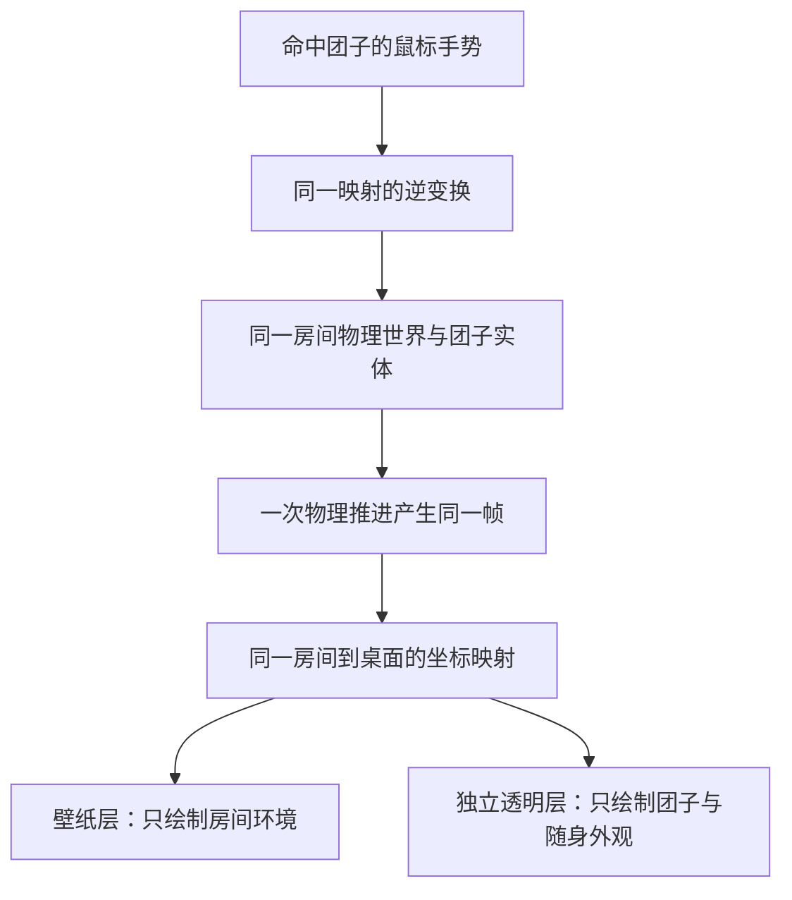

# 桌宠房间分层呈现设计 v0.1

日期：2026-10-07。状态：**单人首阶段设计已通过，用户随后确认开始实施；产品与人工功能验收未完成。**

批准记录：2026-10-07，用户回复“通过”。确认采用一个物理房间、两个显示表面，以及第 4 节 A 方案：松手后按重力落回同一房间地面。第 7 节标明的体验建议保留候选排期，不因本次通过自动成为首阶段必做功能；具体技术、分层视觉小样与实施计划仍需后续核对。

实施记录：同日用户回复“确认，开始实施”。按[实施计划](2026-10-07-desktop-pet-room-layered-implementation-plan.md)推进真实分层候选；本次授权不包含合并、推送、日常安装更新或正式 DLL 替换。

后续体验调整以[用户反馈修订](2026-10-07-desktop-pet-room-feedback-revision.md)为准：默认 1.4 倍、主屏可用区域边界、隐藏边界线，以及拖动／松手问题的定位和验证。本文件保留首轮设计历史。

用户已退回上一轮候选。本文件以本轮新理念为准，从 `main@8ff78e0` 的已有能力讨论重新设计；上一候选及其测试通过不构成本设计的验收证据。用户撤回工作树中的修改保持原样。

## 1. 已确认的产品方向

| 本轮确认 | 设计含义 |
|---|---|
| 桌宠房间本质上是单机房间，将来支持双人联机 | 单人可独立运行，联机是追加能力。本期没有账号、第二席、网络或同步前置 |
| 有普通房一样的真实房间，强制显示在壁纸层 | 有实际房间场景、地面和物理活动空间；不能只留下透明桌面上的一只团子，也不提供“用窗口打开桌宠房” |
| 团子独立显示，可以位于其它应用上方 | 房间和团子使用不同显示表面；房间保持在桌面后方，团子能出现在普通应用上方 |
| 首阶段先完成分层、点击／轻抚／拖动 | 本期不读取窗口边缘作为平台，不做窗口移动跟随、攀爬或桌面平台识别 |
| 团子以房间地面为基础，可以被拖到桌面其它位置 | 拖动越过应用画面属于同一团子的连续活动，不创建桌面副本或切换成另一只团子 |

松手后的落地方式已确认采用重力方案，见第 4 节。下文首阶段空间、输入和生命周期规则纳入本次设计；第 7 节的附加体验建议仍按各自候选排期处理。

## 2. 房间与团子的关系

采用 **一个物理房间、两个显示表面**。房间有真实的墙面／地面呈现和物理活动空间；团子属于这个房间，但绘制在独立的透明上层窗口中。

从用户视角看，房间在桌面上，团子可以来到正在工作的应用上方。应用遮住房间，只改变可见遮挡，不删除房间地面，也不停止团子物理活动。首阶段应用窗口没有碰撞，团子不会自动站到其标题栏上。

已确认的显示顺序：

| 顺序 | 内容 | 行为 |
|---|---|---|
| 上层 | 独立透明的团子、眼睛、帽子等随身外观 | 可在普通应用上方显示；没有整屏遮罩或不透明窗口底色 |
| 应用层 | 用户正在使用的软件 | 保持原有焦点、键盘输入和团子之外的鼠标操作 |
| 桌面图标层 | 系统图标及桌面操作 | 房间环境不吞图标操作；团子之外的空白可操作 |
| 壁纸层 | 完整房间环境 | 固定承载房间，不把整个房间置顶到应用上方 |

“独立显示”是显示职责拆分，不等于独立物理世界。房间背景不得再绘制第二个身体；两个窗口也不得各自推进一次物理。普通房和桌宠房保留不同的呈现策略。

## 3. 首阶段房间与空间

首阶段复用已确认普通房的简约墙面、连续地面、边界材质和团子外观，先把空间与交互做完整。本期不新增家具编辑器、装饰包、房间 DIY 或复杂地形。

地面保留普通房已定义的真实碰撞与视觉关系，包括现有视觉抬高约定；环境、身体、帽子及接触位置必须使用同一投影。不能为了上层显示另造一条屏幕底边地面，造成房间内外两套落点。

首阶段从主屏单屏开始，采用稳定的一档初始视角；不新增独立团子缩放、拖动触发相机跟随或桌面滚轮变焦。既有 `2160 × 360` 房间世界不能直接当作桌面像素：需要明确一套 Room→Desktop 变换，将当前房间可活动范围映射到本机安全显示区域，环境、团子和鼠标逆映射共同使用它。

允许团子被拖到房间画面上方、普通窗口前方等位置，但仍在本期安全区域内。拖动经过应用时不自动换坐标域、不复制实体、不产生“离房再入房”。任务栏、屏外和无法显示的区域不作为可放置点。跨屏迁移列为后续增量；系统显示配置变化时清理拖动并提供安全恢复，不能留下失联的上层窗口。

## 4. 拖动与松手：已采用重力方案

已经确认的手势关系：左键短点击产生轻点反馈，左键拖动抓起团子，沿用 Shift＋左键横向轻抚。手势阈值沿用已确认交互模型，实施前再核对；不凭本设计随意增加新的长按动作。

| 松手方案 | 体验 | 代价 |
|---|---|---|
| **A：按重力落回同一房间地面（已批准）** | 团子可以被举到应用上方，松手后以真实物理落到房间地面；应用暂不阻挡 | 房间被遮住时，地面位置不直观，可用短暂落点提示帮助理解 |
| B：停留在松手位置（未采用） | 便于把团子放在工作区域某处陪伴 | 需要明确悬停状态及回地面动作，不能用冻结普通物理帧冒充自然站立 |

采用 A 是为了延续真实房间地面与现有物理关系，避免首阶段另引入悬停状态。B 保留为未采用的替代方案。本期没有真实窗口平台，不能把松手落在窗口上解释为已实现站立碰撞。

拖动开始后由自身窗口维持捕获，跨过应用画面仍连续。松手、捕获丢失、打开菜单、隐藏、返回及宿主故障必须结束手势并清输入，旧回调不得补播。应用切换或失焦不启动新手势；已经捕获的连续拖动按明确的捕获生命周期处理，不能每帧要求桌面重新取得焦点。

## 5. 工作时的输入与显示

本期核心验收场景是：浏览器或其它普通应用在前台，团子仍在上方；用户可以直接点击、轻抚或拖动它，操作完继续在原应用输入。

- 上层宿主不主动激活，不抢键盘焦点，不出现在任务栏；只有命中团子的可交互轮廓才接受鼠标。透明空白角、身体之间的空隙和宿主其它区域都交给下方应用。
- 不能沿用旧壁纸玩法“Explorer 桌面必须前台”的统一资格限制，否则恰好阻止本次要做的应用上方互动。房间背景输入与团子自身输入分别判定。
- 普通最大化应用仍属于本期可用场景，不能当成全屏而把团子隐藏或禁用。独占全屏、其它置顶窗口和系统特殊界面的覆盖能力需要分别实测，不承诺无条件覆盖所有软件。
- 首阶段不新增对工作应用的全局 A／D／S／Space／Esc 捕获。需要主动键盘玩法时，另行明确进入和退出控制模式；当前已有首页与普通房局部按键规则保留。
- 自身右键采用精简菜单：房门、暂时隐藏、恢复和控制中心；找团子／回到地面的附加动作见第 7 节候选建议。菜单只因用户明确操作打开；关闭菜单不强制把焦点送给 Explorer。
- 首阶段无需读取应用标题、内容、截图、剪贴板或输入历史。窗口平台后续只讨论必要的临时几何，不把真实桌面信息存档、上传或写进协议。

“全屏时自动安静”是值得加入的后续／待确认建议，与普通最大化应用必须可用分开。第一阶段的可见性不能由旧最大化窗口阻断策略直接决定。

## 6. 进入、隐藏、返回与恢复

沿用首页→门廊→桌宠房门的入口，入口与普通房区分。目标成功需要**同一次进入的双表面就绪**：房间环境已实际呈现、当前实体的新健康身体帧已在独立团子层实际呈现，坐标映射一致，且物理 owner 始终最多一个。两个显示表面完成前，不收起唯一可恢复来源，也不开启目标输入。

任一层失败、超时或用户取消，都不能把“只看见团子”或“只有空房间”当作成功。第一阶段将房间整体作为恢复单位：停止目标输入、释放 owner，收起不完整目标，并保留门廊或托盘的重试入口。迟到的旧代际回调无效。

“暂时隐藏桌宠房间”同时收起环境和团子，暂停当前物理与输入，保留本次房间选择和实体状态。恢复同一实体、位置及当前外观，重新核对双表面首帧，不补播隐藏时间和手势。**两个表面独立承载，不默认增加两个独立开关。**只隐藏房间或只隐藏团子的产品模式可另行讨论。

房门返回门廊时，两层作为同一个场景退出。源画面可短暂冻结，目标门廊的新健康帧确认后再完成交接；不能让房间收起而团子孤立留在应用上方。托盘必须能返回或找回，控制中心只用于查看／恢复，不能再次启动首页团子 owner。

单人首阶段沿用已保存外观；会话内隐藏保持位置。跨重启房间存档、再次启动自动入房和布局编辑均需独立设计，本期不擅自改变现有首页启动规则。

## 7. 我的体验建议

以下为附加体验 idea，保留建议性质，不因整体设计通过就成为首阶段必做功能。可在后续分层小样与实施计划中明确是否纳入及具体形态。

| 想法 | 具体效果 | 建议排期 |
|---|---|---|
| **抓起时保留空间联系** | 抓起团子时在真实房间地面显示很淡的预计落点，应用遮住房间时可在落点附近临时显示小提示；结束手势即收起 | 已选重力方案，可作为首阶段候选小增量；提示只能跟真实物理落点一致 |
| **找团子／回到地面** | 右键／托盘可以短暂提示当前位置；另一个明确动作把同一实体放回房间地面安全位置 | 建议首阶段纳入恢复体验，避免拖远后只能重启 |
| **保持安静但可碰触** | 默认没有常驻操作栏；鼠标靠近时才出现很短的操作提示，主动操作才反馈 | 首阶段可做最小提示，具体形态待看小样 |
| **全屏时自动收起上层团子** | 看视频或游戏时减少打扰，退出后回到本次位置；最大化办公应用不触发 | 后续或单独确认后增加，不能以模糊全屏检测扩大本期范围 |
| **窗口成为临时平台** | 后续可站标题栏、跟随窗口移动；窗口关闭／最小化时自然失去支撑 | 明确后置，需要窗口几何、碰撞和失效规则的独立设计 |

视觉建议延续已认可首页与普通房的暖白、棕灰和少字风格。先做一张可点击的分层小样确认“房间在后、团子在前”的观感，再进入生产实施，避免只凭测试完成却偏离产品体验。

## 8. 为未来双人保留的边界

本期生产场景只有一只本地团子。数据概念保留稳定实体 ID、房间逻辑坐标及实体集合；呈现层从统一场景帧读取，不把“一个覆盖窗”写死为“一个玩家”。本期不放第二个假团子演出联机。

未来两人应看见同一逻辑房间，但各自电脑的应用、鼠标和桌面仍属本地。联机只同步经设计确认的团子／房间动作结果，不同步 HWND、窗口标题、截图、原始鼠标轨迹或本机像素布局。

后续窗口平台会造成不同电脑的本地支撑差异，必须单独解决“本地互动结果如何进入双人裁定”，不能直接把本机窗口当成共享碰撞。连接手段、裁定进程、访客权限及跨电脑映射另行设计；当前不把 LAN、中央服务器或正式账号作为单人运行前置，也不声称既有同机原型已满足双人产品。

产品基线、产品概述、入口设计和阶段状态已按本轮单人呈现同步为“壁纸层房间环境＋独立上层团子”。旧账号、固定访客及服务端准入规则保留为正式在线增量的独立边界，不作为本地单人前置；未来双人连接与裁定仍需另案设计，本次通过不自动选定中央服务器或 LAN 方案，也不修改服务端 ADR。

## 9. 首阶段可失败验收标准

| 检查 | 必须失败的情况 |
|---|---|
| 完整真实房间 | 只有透明桌面团子、截图背景、假地面，或提供桌宠房独立窗口模式 |
| 分层唯一实体 | 房间背景仍画身体、上层生成第二实体、帽子或阴影跟另一套帧走 |
| 应用上方可互动 | 普通／最大化应用前台时团子消失，或因 Shell 非前台不能点击／轻抚／拖动 |
| 透明与焦点 | 空白角拦截下层应用点击；点击团子后键盘焦点被抢；下层滚轮／输入被整屏宿主吞掉 |
| 手势与落地 | 捕获中跨应用跳变；松手后悬停或落到另造的地面；没有窗口平台却假装站在窗口上 |
| 坐标与地面 | 背景和身体独立缩放；鼠标点位错位；出现第二地面；DPI 变化后身体／帽子漂移 |
| 双表面首帧 | 只有背景成功、只有团子成功、旧帧或旧 attempt 就收起来源并开放输入 |
| 单 owner | 两个表面各推进物理；打开控制中心启动第二帧驱动；隐藏后仍推进物理或手势 |
| 生命周期恢复 | 隐藏／返回／捕获丢失／任一层故障后仍有吞输入透明窗、孤立身体或失去重试入口 |
| 隐私与双人边界 | 本期采集应用内容或输入历史；单客户端／双本地实体被当成联机验收 |

验证分静态／合同、原生与宿主集成、真实 Windows 行为及用户人工体验；本文没有执行这些检查，不提供功能通过结论。人工核心链：完整房间入壁纸→打开普通及最大化应用→点击／轻抚／拖动上层团子→松手后按重力落回同一房间地面→透明处操作下层应用→隐藏恢复→返回门廊。

## 10. 已有能力与实现缺口（只读核实）

| 当前能力 | 可以参考 | 尚未证明 |
|---|---|---|
| [LocalRoomWallpaperHost](../../src/Dango.Desktop/AppShell/Rooms/LocalRoomWallpaperHost.cs) 与 [LocalRoomSceneView](../../src/Dango.Desktop/AppShell/Rooms/LocalRoomSceneView.cs) | 完整房间环境、WorkerW 挂接、房间投影与物理接入 | 本设计双表面分离和真实应用上方体验；普通房壁纸历史互动问题仍未关闭 |
| [DesktopDangoSceneOverlayWindow](../../src/Dango.Desktop/DesktopHost/WorkerW/DesktopDangoSceneOverlayWindow.cs) | 从同一帧显示身体／帽子，坐标映射回调，不激活鼠标处理 | 当前没有 Topmost 设置；矩形命中不能证明真实透明轮廓穿透；不能原样宣称应用上层交付 |
| [HostFrameScheduler](../../src/Dango.Desktop/DesktopHost/HostFrameScheduler.cs) | 同一 runtime 的帧 owner 排他边界 | 双表面首帧联合确认与实际渲染完成门禁 |
| [壁纸输入资格](../../src/Dango.Desktop/DesktopHost/WorkerW/WallpaperWheelInputPolicy.cs) | 背景滚轮和 Shell 资格参考 | 普通应用前台上的团子输入；不能直接沿用最大化／Shell 否决策略 |

实施方向是复用房间宿主和物理运行时、拆出环境绘制与独立团子呈现、增加统一映射及双表面交接。文件所有权、任务拆分与验证顺序见[实施计划](2026-10-07-desktop-pet-room-layered-implementation-plan.md)；本段不构成任何未执行检查的通过结论。
