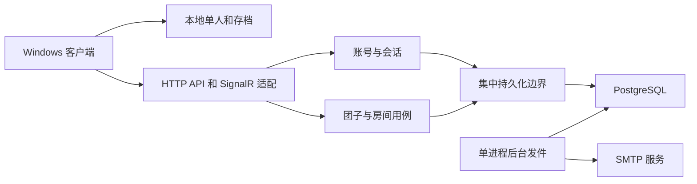

# 邮箱账号与房间服务端首期设计

日期：2026-10-08。状态：**用户同意开始，本地首期进入实施准备与 B0 基础实现**。本轮确定本地正式服务端的账号、团子与房间数据闭环，客户端继续支持完整离线单人和本地存档。用户要求正确性、一致性、安全性、可靠性和扩展性贯穿设计，已写入根级规则。实施顺序与资源边界见[实施计划](2026-10-08-email-backend-implementation-plan.md)；编码授权不包含既有数据库操作、真实发信或部署，设计通过不代表功能验收。

## 1 已确认的产品选择

- 首期采用邮箱与密码登录，先做邀请制测试；受邀者验证邮箱后才能建立正式账号。微信登录后置。
- 首期后端覆盖账号、一只主要团子与房间。好友、情侣以及依赖好友的房间邀请另行安排。
- 未登录、断网或服务端不可用时，完整单人仍可运行并保存本地数据；在线共同房需要登录和服务端准入。
- 新账号使用用户同意采用的本机团子配置初始化唯一账号团子。已有账号保留本机和服务器两份配置，由用户手动选择外观／配置来源；账号团子的唯一身份保持不变。
- 沿用已有房型、容量、创建额度、无房间、解散和恢复规则，见[产品基线](../product-design-v0.1.md#3-核心对象与规则)与[服务端基线](../server-design-v0.1.md#8-关键事务)。

## 2 当前基础与首期范围

已批准技术是 .NET 10、ASP.NET Core 模块化单体、SignalR、PostgreSQL 18、EF Core 10 与 Npgsql 10.x，见[ADR 0002](../adr/0002-server-foundation-and-scaling.md)。首期只运行一个服务实例，数据库访问集中管理。

当前[服务端入口](../../src/Dango.Server/Program.cs)是父进程通过匿名管道启动的同机同步原型；[房间运行时](../../src/Dango.Server/Rooms/RoomRuntime.cs)和[快照存储](../../src/Dango.Server/Storage/InMemoryRoomSnapshotStore.cs)不能承担正式账号、多房间或跨进程重启持久化。客户端已有[外观存档](../../src/Dango.Desktop/AppShell/ControlCenter/AppearanceSettingsStore.cs)，本地房间入口和物理呈现可继续沿用。

首期交付能力如下，不能把阶段内的受限能力记成完整社交房间已交付。

| 对象 | 首期能力 | 后续能力 |
|---|---|---|
| 邮箱账号 | 受邀注册、验证、登录、注销、密码修改／找回、会话撤销 | 邮箱更换、账号注销、第三方登录 |
| 主要团子 | 初始化、读取、显式保存受支持外观、版本冲突处理 | 创作资产上传、身体物理 DIY |
| 默认桌宠房 | 自动建立唯一记录、房主查询及归属接口 | 固定好友第二席、真实双人桌宠接入 |
| 私密共同房 | 房主创建、列表／详情、配置修改、进退、解散与恢复 | 好友邀请、长期访客、管理成员 |
| 公共共同房 | 创建／配置、有效码准入、容量、离房、移出／封禁、解散与恢复 | 完整多人玩法和跨设备视觉验收 |
| 本地单人 | 原有玩法、房间与外观存档、断服继续游玩 | 云端房间布局同步、复杂离线合并 |

测试注册邀请只授予注册资格，不能成为好友关系、桌宠第二席或私密房间准入资格。首期没有好友系统时，所有依赖好友的非房主准入均明确不可用；公共房可通过有效码验证真实多账号业务。

## 3 模块与认证方案

建议复用 ASP.NET Core Identity 的密码哈希、账号锁定和密码找回能力；使用自定义注册编排，不直接开放默认注册端点。默认 Identity API 是先创建用户再发送确认，本次要求先验证邮箱，再原子建立账号、团子和默认房。

Windows 首期建议使用 Identity Cookie 与持久会话表，HTTP 和 SignalR 共享受控 CookieContainer。每次业务请求及 Hub 命令均复查会话是否撤销／到期，并重新检查房间权限。注销、改密、找回成功或账号禁用后，旧会话与旧连接的后续命令被拒绝；撤销提交后关闭／移出受影响连接，出站收件人也重验会话与权限，避免关闭之前继续泄露新的受保护广播。

Cookie 设置 HttpOnly、Secure 和适当 SameSite。WPF 先通过 GET /auth/request-protection 领取框架防伪证明，同一 CookieContainer 保存配套 Cookie；登录、注销、注册与所有写操作在 X-CSRF-TOKEN 请求头携带证明，登录／注销后重新领取。邮件确认页单独领取与该浏览器 Cookie 绑定的防伪证明。浏览器 Origin 必须匹配允许来源；无 Origin 的原生请求仍须证明，不能用 User-Agent 绕过。原生 SignalR 协商／WebSocket 建连同样携带防伪头并检查浏览器 Origin，跨站浏览器 WebSocket 被拒绝。

客户端仅向明确配置的服务端发送凭证。默认会话仅保存在内存；“记住登录”使用 Windows 安全存储，并绑定服务端和账号，不能把 Cookie 或密码写进普通存档。建议普通会话绝对期限 8 小时、记住登录最多 7 天，到期重新登录，首期不增加独立刷新令牌协议。

Identity 的安全戳校验不能替代每次请求的会话撤销检查。SignalR 在到期时断开并重新认证；不使用属于 .NET 11 及以上的认证刷新接口。正式在线归属、控制会话和账号登录会话分开管理，多设备登录不会创建第二只团子。

## 4 数据模型与约束

以下为逻辑模型；Identity 必需的内部映射在迁移设计中明确，房间角色由领域规则裁定，不引入全局业务管理员角色系统。

| 实体 | 关键字段或状态 | 必须保证 |
|---|---|---|
| users | 稳定 ID、邮箱、规范化邮箱、密码哈希、安全戳、状态 | 规范化邮箱数据库唯一；正式账号邮箱已验证 |
| test_invitations | 绑定邮箱、邀请摘要、到期、撤销、消费时间／账号 | 一次消费；不是房间权限；签发仅供测试维护入口 |
| pending_registrations | 邀请、邮箱、请求幂等键、继续秘密摘要、Pending／Verified／Completed 状态、期限、完成幂等键及固定结果 IDs | 注册前不创建正式用户；不保存待注册密码；Completed 不再消费邀请或改配置 |
| email_challenges | 主体、用途、generation、绝对到期、验证／消费／撤销状态 | 用途隔离、重发撤销旧证明、原子一次消费 |
| email_jobs | challenge ID、generation、模板、重试／租约状态、脱敏错误码 | 不保存正文、完整链接、原始证明或 SMTP 密钥 |
| auth_sessions | 用户、会话 ID、建立／到期／撤销时间 | 每次请求检查；不保存原始 Cookie |
| room_device_leases | 登录会话、客户端实例、Pet、观察／控制资格、最近心跳、租约截止、终止状态 | 与登录期限分开；只能一个控制方，多设备观察不复制占位 |
| pets | 稳定 ID、唯一 user ID、受支持配置、配置版本 | 每账号最多一只；活动账号初始化必须有且只有一只 |
| rooms | 类型、房主、名称、容量、状态、版本、解散／恢复截止时间 | 默认桌宠房每房主唯一且不可解散；共同房类型不可互转 |
| room_memberships | 房间、账号、角色、长期席位状态 | 房间与账号组合唯一；首期私密／桌宠仅有房主席位 |
| pet_room_states | 唯一 pet ID、可空 room ID、位置／睡眠、当前控制租约、控制代际、归属版本 | 同一团子最多一个有效房间；无房时没有房内占位 |
| public_room_credentials | 房间、入场凭据摘要、版本、失效时间 | 重置／解散后旧码失效，恢复不复活旧码 |
| room_bans | 房间、账号、封禁状态 | 公共码更新不能绕过封禁；不会清空另一房间的团子 |
| domain_outbox | 事件 ID、房间／账号目标、业务版本、发布状态 | 事务提交后通知，漏发可由快照纠正 |
| audit_logs | 操作类型、主体 ID、目标、结果和时间；测试主体使用虚构值 | 高影响操作留痕，不记录凭证和非必要本地信息 |

时间统一存 UTC，房间名称等文本定义长度上限，JSON 配置有 Schema 与大小上限。规范化邮箱统一使用 Identity 的同一 Normalizer；不自行合并邮箱服务商的加号或点号别名。RequireUniqueEmail 的应用检查之外必须有数据库唯一索引。

为避免维护两份归属事实，建议 pet_room_states 集中保存唯一归属和场内状态，API 的 currentRoomId 从此读取；不同时维护一个独立的 pets.current_room_id 权威字段。无房记录的坐标、睡眠和占位必须清空。房间归属是持久事实，连接列表与活跃运行实例是可重建状态。

默认桌宠房的唯一索引、pets.user_id 唯一索引和初始化事务共同保证默认对象数量；正式活动账号不能暴露尚未完成初始化的状态。共同房三间额度和房间容量涉及多行并发，由数据库事务与统一锁规则保证，不能只依靠界面禁用或操作前计数。

首期布局仅记录现有场景模板 ID 与版本，不添加家具编辑、图片上传或对象存储依赖。未来扩展的外部登录身份可以关联内部 user ID；本期不创建空的微信凭证或伪装微信接入。

## 5 注册与邮件流程

1. 测试维护入口签发绑定邮箱、有期限的一次性邀请。邀请签发／撤销需要维护权限，不对普通账号开放；不以未经鉴权的 API 代替邀请管理。
2. 客户端提交邀请、邮箱、请求幂等键，以及本机密码学安全随机生成的 256 位继续秘密。服务端只保存秘密摘要，绑定 pending 与服务端；后续通过 X-Registration-Proof 请求头验证，不放入 URL、邮件或普通存档。首次响应丢失时，相同幂等键与秘密恢复同一 pending；不能凭新秘密接管既有 pending。该证明仅能继续本次注册，不能调用账号或房间接口。
3. 后台任务发送验证链接。链接 GET 只显示确认页，显式 POST 才验证，避免邮件扫描器自动消费。证明用框架限时 Data Protection，绑定挑战、邀请、邮箱、用途、generation 和绝对到期；验证成功写数据库状态。
4. 原客户端凭继续秘密取得 Verified 状态，提交完成幂等键、密码和明确选定的初始配置。完成期限是 verifiedAt 加 10 分钟，与 pending／邀请截止时间取最早者；不重新要求已消费邮件证明仍处于原有效期。浏览器确认不返回继续秘密，也不能给任意客户端发放登录会话。
5. 在同一 PostgreSQL 事务中重验邀请与邮箱证明、创建 Identity 用户、唯一团子、默认桌宠房和房主席位、初始化唯一归属、消费邀请及注册完成资格。任一步失败整体回滚；Identity Store 与领域存储共用该事务。

完成接口先验证继续秘密，再检查 Completed：相同完成幂等键在建议 24 小时结果保留期内返回固定 user／Pet／默认房 IDs，不重新消费邀请、不改密码或配置、不再创建登录会话；不同完成键报告已完成。首次完成的事务还写入 Completed 状态与固定结果，响应丢失不会造成半套对象。注册完成不自动发登录 Cookie，客户端走标准登录接口。pending 建议绝对期限 1 小时，邮件重发不延长；完成后继续秘密仅能读取该固定结果。

新账号直接用批准的本机配置初始化唯一 Pet，不先创建默认 Pet 再导入第二只。注册按已有初次使用规则建立默认桌宠归属；服务端保存初始安全位置，本地仍须完成真实显示就绪才能呈现在线场景。拥有归属不等于仅凭注册响应就已完成桌面入房。

找回密码对外统一提示，避免泄露某邮箱是否注册；挑战与账号安全戳绑定，调用 Identity 密码重置能力并原子消费挑战、撤销旧会话。密码明文仅在请求处理时存在，不落入 pending_registration、日志或邮件任务。

建议初值：验证／找回链接 30 分钟，验证后完成注册资格 10 分钟，邀请 7 天；每邮箱重发冷却 60 秒、每小时最多 5 次。链接期限不超过 pending／邀请剩余期限；Verified 状态不再重发注册证明。密码候选范围 12–128 个字符，不额外强制字符类别；登录锁定及请求限流须同时覆盖账号和网络来源。数值可配置，评审通过后作为失败型验收输入。

## 6 邮件发送与故障处理

邮件模块只负责模板、SMTP 适配、发送状态和有限重试；账号模块负责挑战的用途、有效期和消费。建议 IEmailSender 加 MailKit SMTP 适配器；B1 新增前核对兼容版本、官方 API、许可证和依赖范围，B0 尚未加入 MailKit。微软不推荐在新开发中采用 System.Net.Mail.SmtpClient。

发件任务与挑战在同一数据库事务中建立，SMTP 调用在事务外执行。单个 BackgroundService 从持久队列取任务，发送前重新检查 challenge generation、期限和消费状态，找回任务还需匹配账号安全戳；证明固定使用挑战绝对截止时间，重试不延长期限。正文与原始证明只在内存中存在。Data Protection key ring 放仓库外并保护，服务重启仍能验证未过期邮件；丢失 key ring 必须显示失效并允许重新发信。

临时故障有限退避，建议最多 5 次；永久拒绝停止重试。SMTP 未配置、认证失败、超时或永久拒绝均有可操作状态；“请求受理”“SMTP 接受”“邮箱已验证”分别展示，不能把排队成功说成送达。

SMTP 接受后进程退出可能使同一任务重复发送，因此只承诺可恢复的至少一次发送尝试，不承诺恰好一次或进入收件箱。重复邮件的证明属于同一 challenge，最多消费一次。注册重发必须持有继续秘密，在同一事务中限频、升级 generation、撤销旧证明并建立新任务；找回密码重发同样撤销同主体的旧挑战。后台任务用持久租约避免同一实例重复处理，崩溃后可回收。

用户后续需准备一个专用发件邮箱及 SMTP 服务配置。密码／授权码、连接串和 Data Protection keys 不提交到仓库，不通过聊天收集或打印；开发 user-secrets 不视为加密保险箱。自动测试使用虚构账号、虚构地址与受控 SMTP 接收器；真实邮件投递由用户另行人工验收。

## 7 团子配置与本地存档

新账号采用本机团子的已应用外观，服务端生成稳定账号团子 ID 并返回绑定；本机对象的导入标识不能成为服务端认证或房间归属依据。重复注册完成请求只会返回同一套已确认结果。

已有账号登录时先读取服务器 Pet 和配置版本，不自动覆盖本机文件或服务器配置。用户预览两份数据后可选择使用服务器配置，或显式将本机支持的配置写入同一 Pet；更新带期望版本，冲突时重新读取并让用户选择。切换配置前保存原本地数据，写入失败保留两份，不创建第二只账号团子，也不改变当前房间、权限或控制权。

首期只关联已实现的外观 Schema 3：身体／眼睛纯色及四个眼部参数。饰品、物理预设和场景布局不因登录自动上传；未知 Schema 和非法参数拒绝，不能静默转换成默认长相再覆盖原文件。

本地房间存档独立版本化，建议保存本地房间 ID、名称、类型、现有场景模板、已应用外观关联、稳定逻辑位置和相机设置。存档用原子写入、严格校验、原文件保护及显式恢复；磁盘写失败应继续本次游玩并显示未保存。重启位置越界时采用明确的安全入场位置，不恢复拖动、按键、原生句柄、瞬时速度或过期动作。

离线单人是本机逻辑会话，不宣称已进入服务器房间或获得在线名额；断服时明确转换／进入离线模式，保留原本地存档。重连只读取最新在线归属，不把离线位置、布局或动作补传成云端权威状态。服务器房型的离线／短断线规则照常执行，不能把“本机继续玩”视为在线连接仍在。

## 8 房间操作与事务

| 操作 | 授权与结果 |
|---|---|
| 创建共同房 | 已验证账号；重验三房额度；创建时选择私密／公共，默认容量 6、范围 1–12 |
| 列表／详情 | 只返回获准条目；公共码校验不产生长期资格，不开放全网目录 |
| 改名／改容量 | 房主与版本检查；缩容不能低于有效长期席位或当前在场数；房型不可互转 |
| 进入 | 重验会话、设备类型、房型、权限、封禁、凭据和容量；原子迁移唯一归属 |
| 正式离房 | 校验 expectedRoomId、归属版本及控制代际后原子进入无房间；迟到旧请求不清空新归属；隐藏、窗口 × 和回门廊不调用此接口 |
| 公共移出／封禁 | 首期仅房主可操作；只影响实际归属目标房的团子；封禁持续阻止新旧码准入 |
| 解散 | 只有房主；默认桌宠不可解散；原子清空实际占位并冻结房间，进入 7 天恢复期 |
| 恢复 | 原房主、期限和三房额度重新检查；不迁回团子，不恢复旧公共码 |
| 到期清理 | 后台幂等任务按精确到期目标清理；保留团子身份与所需审计 |

涉及创建／解散／恢复额度时先锁定房主额度键，随后按房间 ID、团子 ID 的固定顺序锁定必要行。迁移先预读来源，取得相关锁后重新检查最新归属；变化时回滚并有界重试，不能先锁团子再临时补锁任意房间。锁规则集中于持久化用例，不散落在控制器或 Hub。

私密房按长期成员席位计数，公共房按当前归属占位计数；不能用连接数代替团子数。默认桌宠的两席／离线睡眠规则保留，但首期不实现第二席授权和双人桌宠运行。

在线使用独立 room_device_leases：服务端为已认证客户端实例签发租约，心跳更新最近时间与截止，观察资格和控制资格分开。最近一次成功进入／接管的设备获得唯一控制租约并提高控制代际；其他设备只观察，旧设备命令拒绝。有效观察设备仍在时不能仅因控制方断线就正式下线；需要控制时由观察设备显式接管。

建议心跳 10 秒、租约容错 30 秒。账号仍有 8 小时有效 Cookie 但没有有效在线租约时，仍按房型正式下线。全部有效设备租约终止／到期后，桌宠／私密房睡眠并保留占位，公共房进入无房。到期处理锁定并重查最新心跳、会话撤销、归属与代际，旧到期任务不能清掉已经续租／迁移的状态。重启从持久租约重建，超过期限且未续租才处理；不能凭内存空连接表立即清空全部归属。

业务提交同时写版本与 domain_outbox，提交后只通知有权观察的连接及受影响本人；投递可重复，客户端按事件 ID／版本去重。漏发、服务重启或历史事件不可用时请求数据库权威快照。物理与逐帧动画仍由既有同步边界处理，本期房间领域通过不等于真实多窗口玩法同步通过。

## 9 接口合同

HTTP API 位于 /api/v1，使用稳定错误码、关联 ID、期望版本与必要幂等键。ID、房主、角色或客户端显示均不能替代服务端身份与权限。业务响应不包含数据库实体、密码哈希、原始验证证明或其他用户邮箱。

| 接口组 | 首期操作 |
|---|---|
| 防伪 | GET /auth/request-protection；与同一 CookieContainer 绑定，登录／注销后刷新 |
| 注册 | POST /auth/registrations；受保护的 GET /auth/registrations/{id}/status 与 POST /auth/registrations/{id}/resend；POST /auth/email-verifications/confirm；POST /auth/registrations/{id}/complete |
| 会话 | POST /auth/login；POST /auth/logout；GET /me；GET /me/sessions；DELETE /me/sessions/{id} |
| 密码 | POST /auth/password-reset/request；POST /auth/password-reset/complete；POST /auth/password/change |
| 团子 | GET /me/pet；PATCH /me/pet/configuration，携带 expectedVersion |
| 房间管理 | POST /rooms；GET /me/rooms；GET /rooms/{id}；PATCH /rooms/{id}；POST /rooms/{id}/dissolve；POST /rooms/{id}/restore |
| 准入 | POST /room-code/resolve；POST /rooms/{id}/enter；POST /me/pet/leave-room 携带预期房间、归属版本和控制代际 |
| 公共管理 | POST /rooms/{id}/code/reset；POST /rooms/{id}/occupants/{petId}/remove；PUT／DELETE /rooms/{id}/bans/{userId} |
| 实时恢复 | 已认证 Hub 订阅本人状态／获准房间；续租、显式接管、版本化权威快照及服务端时间 |

测试邀请使用受控维护工具签发，不在 /api/v1 增加公开管理后门。账号与团子不机械提供删除 API；账户注销另行设计。房间使用明确解散／恢复接口，避免通用 DELETE 绕过二次确认与恢复期。

客户端关闭控制界面之前，仍须同时满足真实服务端准入与目标健康呈现；宿主失败保留已确认归属并提供恢复。任何重新进入旧房都重新验权和验容量，不能把本地画面回滚当成业务回滚。

## 10 分批顺序

逐文件范围与验证顺序见[实施计划](2026-10-08-email-backend-implementation-plan.md)，各批失败都停止推进相关能力。

| 批次 | 可验证成果 | 外部依赖与停止点 |
|---|---|---|
| B0 数据与配置基础 | 集中 EF 边界、命名本地数据库迁移、约束、持久密钥与测试环境配置 | 需确认精确数据库目标；任何破坏性重置另行授权 |
| B1 邮箱账号 | 邀请、先验证后注册、Identity 初始化、会话及找回闭环 | 自动 SMTP 接收器；真实 SMTP 配置／投递验收单列 |
| B2 团子与本地存档 | 首次采用配置、已有账号两份选择、唯一身份、断服本地保存及重启加载 | 只读既有外观合同；非法版本／写失败不得覆盖 |
| B3 房间管理 | 真实创建、列表详情、配置更新、额度、解散和恢复 | 数据库并发与事务故障必须能失败 |
| B4 准入与恢复 | 公共码多账号准入、原子迁移、无房、封禁、会话／重启恢复 | 私密邀请与桌宠第二席保持后置，不能用注册邀请绕过 |
| B5 Windows 接入 | 登录与离线入口、保存选择、服务端房间目录与操作、健康呈现失败恢复 | UI 具体交互先评审；自动／实时／人工证据分开 |

到期清理逻辑作为 B3 的独立可测任务设计；运行在命名环境前明确精确目标和数据保留政策，不能借测试清掉既有数据库。第一轮只在本地服务端运行，不部署公网或启动付费资源。正式 M7 双 Windows 验收独立保留，不能用本轮 API／同机结果替代。

B1 负责最小配置校验和唯一 Pet／默认房的注册初始化；B2 扩展两份配置选择、本地存档与客户端关联，不再次创建账号对象。这里是批次职责，不表示 B1 已经实现。

## 11 能失败的验收

| 验收场景 | 错误实现必须暴露的失败 |
|---|---|
| 无邀请、撤销／到期邀请、邮箱不匹配、未验证完成注册 | 不创建正式账号、团子或房间；不能只隐藏注册按钮 |
| 证明篡改、跨用途、到期、旧 generation、GET 扫描、并发消费、未经授权重发 | 全部按规则拒绝；同一挑战／邀请最多一次完成；重发限频生效 |
| 规范化同邮箱并发注册 | 数据库最多一个账号；任一初始化步骤失败没有半套对象或被误消费邀请 |
| 首次请求／完成响应丢失、相同和不同幂等键重试 | 同一继续秘密恢复同一 pending；完成后固定结果，不重建对象、修改密码／配置或新发会话 |
| 注销／改密后重放 Cookie 或旧 Hub 命令 | 后续业务拒绝，旧连接不再接收新的受保护广播 |
| WPF 防伪领取／刷新、缺证明、恶意 Origin 与跨站 WebSocket | 合法客户端可用；写操作和建连不能靠无 Origin 或客户端自报身份绕过 |
| SMTP 未配置、认证失败、暂时／永久拒绝、进程退出 | 状态真实、重试有界；SMTP 接受与送达不混淆；重启可恢复任务 |
| 两份外观选择、版本冲突、磁盘写失败 | 账号 Pet ID 不变；原文件与另一份配置保留，无静默覆盖 |
| 完全断网、服务端不可用、本地客户端重启 | 单人仍可玩且读取真实存档；不宣称在线准入，不上传离线位置覆盖云端 |
| 非房主直接修改／解散、公共访客移出／封禁他人、伪造 ownerId、注册邀请入私密房 | 服务端拒绝，数据库原状；未授权详情与成员邮箱不可读 |
| 同时争抢第三间额度或最后一个公共名额 | 至多允许范围内成功；失败不迁移原归属，无重复占位 |
| 迁移中途失败、撤权与入房并发、多设备入不同房、旧房离房请求迟到 | 只有一个最新合法归属；不回填失效来源、不复制团子、不清空新归属 |
| 解散与 7 天恢复、恢复额度满、旧公共码、到期清理重跑 | 解散清空实际归属并释放额度；恢复不迁回、不复活旧码；到期清理幂等 |
| 重启客户端、服务端与数据库后查询 | 身份、配置、房间、归属与有效期限真实保留；旧控制代际拒绝 |
| 登录有效但在线租约过期、重启未续租、另一观察设备仍在、旧到期任务迟到 | 登录与在线分开；按最新有效租约裁定下线，不误释放新归属或另一设备仍在的占位 |
| 隐私与日志检查 | 无密码、Cookie、授权码、完整链接、连接串、真实测试账号或本地窗口／输入内容 |

测试账号和地址使用虚构值；自动接收器和假邮件适配器结果只证明其对应边界。真实邮件投递、Windows 交互、多客户端视觉、不同 DPI、长期运行与容量分别报告，不能由表中测试推定通过。

## 12 决策理由与后续评审

邮箱密码先行可由个人开发阶段直接控制，微信资格和审核不会成为本轮数据库设计前提。复用 Identity 避免自行实现密码算法；独立 pending_registration 才能满足先验证后注册。Cookie 加持久会话表复用框架认证，并给注销和 Hub 命令提供真实撤销边界；JWT 与独立身份服务首期不引入。

同库待发任务和单个后台 worker 提供重启恢复，代价是可能重复邮件；数据库一次消费比承诺 SMTP 恰好一次更符合实际。归属与占位集中在同一记录，减少相互矛盾的持久事实。私密成员与桌宠第二席后置遵守好友前提；注册邀请不能代替关系系统。

用户同意开始后，Identity／Cookie 会话、注册编排、归属集中模型与事务边界记录为[ADR 0006](../adr/0006-email-accounts-and-persistent-room-state.md)。具体依赖版本在各批新增前核对官方类型和许可证，MailKit 仍待 B1 核验。发件邮箱、SMTP 参数和精确本地数据库目标由实施配置阶段确定，不通过聊天收集真实凭据。

### 12.1 五项质量要求与恢复边界

正确性覆盖合法／非法输入、期限边界和版本拒绝；一致性使用数据库约束、统一锁顺序、事务与幂等，测试通过独立连接制造竞争并读取提交后的事实；安全性同时检查请求权限与受保护广播的收件人；扩展性要求列表、邮件、租约和 outbox 批次有界，索引与前向迁移支持演进，不提前增加分布式组件。

可靠性分为正常进程重启和备份还原。重启沿用有效密钥与数据库事实，过期租约按最新状态处理；备份还原可能回滚撤销／消费记录，必须在维护隔离中恢复，禁止 API、Hub、真实邮件和任务投递。还原目标使用独立命名库，原库不受影响；恢复前后比对业务行、约束、迁移和孤儿记录，备份及密钥在仓库外受访问控制保护。

从旧备份恢复为可服务环境时，使用新的外部恢复代际与独立 Data Protection 隔离，撤销恢复库中的全部旧登录会话、未完成注册、邮件挑战／待发任务、测试邀请、公共码和设备租约。注册继续秘密另绑定创建时恢复代际，旧代际的 Completed 重试也拒绝。公共占位释放为无房，桌宠／私密占位按合法资格转睡眠，控制代际提高；团子身份、外观、房间及审计保留。

备份也会回滚 PasswordHash 和账号禁用状态，故全部恢复账号先进入恢复锁定。维护者核对还原点之后的禁用／注销事实，仅明确批准的账号可以通过新邮件挑战重置密码并解除恢复锁定；无法确认的账号保持锁定。公开找回、注册邀请、邮箱验证或正确旧密码均不能自行解除恢复锁定或原有禁用。旧 Cookie、继续秘密、证明、邀请、码与旧密码均不能复活。该处理是明确的恢复维护事务，需要精确目标数据授权；不得在正常启动时自动执行。未完成真实还原及旧凭据拒绝验证前不能宣称可靠性门禁通过。

恢复锁定独立于 Identity 的临时登录锁定；维护审批只允许签发专用恢复挑战，不直接激活账号。挑战绑定账号、邮箱、恢复代际和审批版本；完成事务重验审批未撤销及最新账号状态，一次消费挑战、用 Identity 更新密码与安全戳并撤销旧会话后才解锁。新密码不得与恢复库中的旧 PasswordHash 匹配，避免解锁后旧密码再次有效；审批撤销与完成并发必须有且只有一个合法结果。

环境先完成凭据撤销和全部账号锁定，再进入受控恢复阶段；SMTP 发送在维护事务之外，发送时也重验审批。维护审批沿用受保护本地工具，不能依赖恢复库中的旧 Cookie／角色或邮箱持有；恢复锁定贯穿登录签发、HTTP／Hub 命令及出站收件人。新邀请只能注册符合规则的新账号，不能恢复旧账号权限。

### 官方资料

- [ASP.NET Core Identity](https://learn.microsoft.com/en-us/aspnet/core/security/authentication/identity?view=aspnetcore-10.0)
- [Identity 配置与密码哈希](https://learn.microsoft.com/en-us/aspnet/core/security/authentication/identity-configuration?view=aspnetcore-10.0)
- [邮箱确认与密码找回](https://learn.microsoft.com/en-us/aspnet/core/security/authentication/accconfirm?view=aspnetcore-10.0)
- [限时 Data Protection](https://learn.microsoft.com/en-us/aspnet/core/security/data-protection/consumer-apis/limited-lifetime-payloads?view=aspnetcore-10.0)
- [.NET 10 Identity 注册端点源码](https://github.com/dotnet/aspnetcore/blob/v10.0.0/src/Identity/Core/src/IdentityApiEndpointRouteBuilderExtensions.cs)
- [SignalR 认证与授权](https://learn.microsoft.com/en-us/aspnet/core/signalr/authn-and-authz?view=aspnetcore-10.0)
- [SMTP 客户端官方建议](https://learn.microsoft.com/en-us/dotnet/api/system.net.mail.smtpclient?view=net-10.0)
- [EF Core 事务](https://learn.microsoft.com/en-us/ef/core/saving/transactions)
- [Data Protection key 配置](https://learn.microsoft.com/en-us/aspnet/core/security/data-protection/configuration/overview?view=aspnetcore-10.0)
- [开发 secret 的边界](https://learn.microsoft.com/en-us/aspnet/core/security/app-secrets?view=aspnetcore-10.0)
